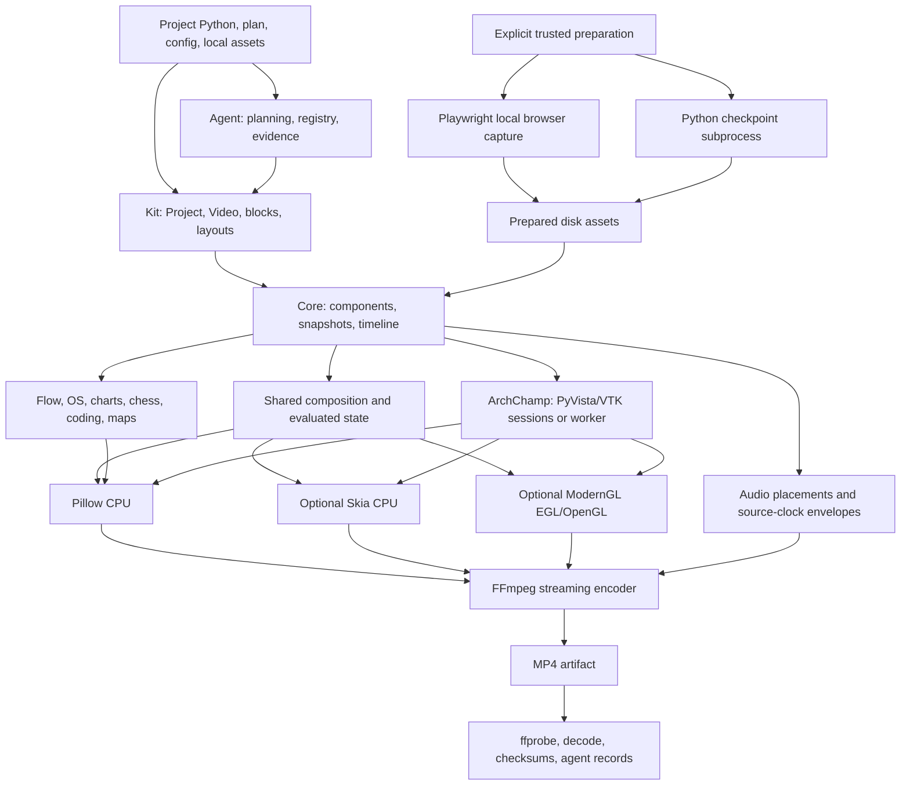

# FacelessChamp repository audit

Audit date: 2026-10-20. Source revision: `bf42755f9f89a9e00aa6c567ffb6eb6b79ba2214` (`build123 integrate`).

Sections 1–7 preserve the original audit and its proposed repair plan. During that audit phase no production code, tests, manifests, website files, or assets were changed. The subsequently authorized implementation and current validation are recorded in section 8. Baseline diagnostics are under `/tmp/fc-full-audit*`; repair diagnostics are under `/tmp/fc-audit-fixes`. No remote render jobs, browser downloads, commits, pushes, or repository cleanup operations were performed.

## 1. Executive summary

The audit confirmed **17 findings: 2 P1, 11 P2, and 4 P3**. No P0 issue was confirmed. This does not establish the absence of security vulnerabilities or other defects.

The most immediate failures are clean-checkout narration resources missing from version control and a documented Roadster Colab integration whose implementation modules are absent. Core correctness defects include shorter composition children losing their held image, a valid OS UI scroll crashing rendering, and accepted overlapping subtitle cues disappearing early. Kit and agent contracts have additional gaps in initial code visibility, export quality selection, design validation, native typography, evidence recovery, and a packaged JSON Schema.

The primary package suites passed: **1,913 passed, 2 skipped**. Separately, the Roadster local suite passed **16 tests**, but its complete test directory cannot collect because `colab_common` is missing. Explicit browser tests produced **49 passed, 2 failed** because the Chromium executable required by the installed Playwright version is absent. Those browser failures are an environment blocker, not confirmed browser implementation defects. The existing website verifier also failed on stale generated package metadata.

The three requested historical checks are **not reproducible on the audited stack**:

| Historical concern | Current evidence | Disposition |
| --- | --- | --- |
| Sparse vector glyph sampling | Four point/cell and grid/sphere regression cases passed; sampling now explicitly excludes incident cells. | Current fix verified on Linux/PyVista 0.49.1/VTK 9.7.1. |
| Capped section clipping orientation | Six normal/transform regression cases passed; capped clipping negates the plane normal to preserve the uncapped half-space. | Current fix verified on this stack. |
| Structured `ArchCanvas` design configuration | Eight cases passed covering explicit settings, omitted settings, copying/replacement, empty annotation overrides, default units, and invalid annotations. | Current precedence/sentinel implementation verified. |

Review included a repository-wide Python inventory, dependency/import analysis, systematic contract review of all 145 package source modules, targeted ancillary script/example review, all three package test suites, clean tracked-source distribution builds, isolated wheel imports, and focused failure reproductions. **Coverage is bounded:** ancillary scene drawing code received static and targeted review rather than complete frame-by-frame review; real browser capture, other Python/OS versions, hardware GPUs, cloud execution, and long/full-resolution exports remain unverified. No claim is made that every problem has been found. Section 4 distinguishes review depth by area.

### Ranked finding index

| ID | Severity | Confirmed problem | Main boundary affected |
| --- | --- | --- | --- |
| FC-AUD-001 | P1 | Required narrated starter/example audio is ignored and absent from clean distributions | Git/assets → Kit → Agent/examples |
| FC-AUD-002 | P1 | Roadster Colab entrypoints and tests reference absent implementation modules | Project → cloud launcher |
| FC-AUD-003 | P2 | Layer/Grid sample an ended child after its visible lifetime | Timeline → all composition backends |
| FC-AUD-004 | P2 | Large legal Finder scroll produces an inverted scrollbar rectangle and crashes | OS model/layout → drawing |
| FC-AUD-005 | P2 | Nested tolerated subtitle overlaps lose an otherwise active cue/phrase | Subtitle intervals → captions |
| FC-AUD-006 | P2 | Coding tutorial's `reveal = 0` does not initialize timeline visibility | Kit template → core state |
| FC-AUD-007 | P2 | Kit quality-only profiles retain default explicit dimensions | Kit profiles → core export |
| FC-AUD-008 | P2 | Engineering example always supplies width without height | Example CLI → export validation |
| FC-AUD-009 | P2 | Agent build validation omits planned typography/surface policy | Agent design → Kit theme report |
| FC-AUD-010 | P2 | MetricCard's value ignores the selected text engine | Theme → block → Number |
| FC-AUD-011 | P2 | PNG helpers can overwrite a concurrently created file with overwrite disabled | Preview → artifact publication |
| FC-AUD-012 | P2 | A malformed evidence record crashes agent status outside structured error handling | Persistent records → agent CLI |
| FC-AUD-013 | P2 | Bundled benchmark schema rejects current quality-report payloads | Pydantic model → packaged schema |
| FC-AUD-014 | P3 | Nested groups retain quadratically many component snapshots | Hierarchy → timeline memory |
| FC-AUD-015 | P3 | Generated website metadata is stale and its verifier fails | Manifests → documentation generation |
| FC-AUD-016 | P3 | ArchChamp agent guide documents an invalid discovery command | Documentation → capability CLI |
| FC-AUD-017 | P3 | Release gallery silently clips the eleventh recipe | Recipe registry → QA contact sheet |

## 2. Architecture and dependency map

### Inventory and ownership

The tracked checkout contains 1,244 files, including 278 Python files and 56,576 Python lines. Counts include package initializers, test configuration, sample factories, and project-local scripts; they are not executable coverage measurements.

| Area | Python modules/files | Lines | Responsibility |
| --- | ---: | ---: | --- |
| `src/faceless_champ` | 92 | 18,874 | Components, immutable authoring snapshots, timelines, rendering, specialists, media export |
| `facelesschamp-kit/src/facelesschamp_kit` | 38 | 4,508 | Build context, project configuration, blocks/layouts, compiler, templates; includes seven sample factories |
| `facelesschamp-agent/src/facelesschamp_agent` | 15 | 4,316 | Plans, capability registry, context discovery, layout/media checks, evidence and delivery |
| Three package test directories | 75 | 13,856 | 761 test functions before parametrization |
| Root `scripts` | 5 | 694 | Geometry/render benchmarks, probes, map preparation |
| `examples` | 5 | 1,040 | Engineering/native backend examples and narrated programming scene |
| `my-project` | 38 | 11,444 | Standalone visual projects, Roadster project/tests, bundled Colab helper |
| Website scripts / project atlas builder | 4 | 1,341 | Offline documentation and repository-map generation |
| Kit/agent developer scripts | 6 | 503 | Distribution, fixture, catalog, and release media tools |

The AST dependency inventory found **557 internal import edges**, including lazy imports. No forbidden core → Kit/Agent or Kit → Agent import was found. This is an import/ownership check, not a proof that every behavioral contract is enforced.



### Packages, APIs, and external dependencies

| Package | Manifest and runtime contract | Audit result |
| --- | --- | --- |
| Core `0.1.6` | [pyproject.toml](../../pyproject.toml): Python `>=3.12`; Pillow `>=10.4,<13`; mandatory PyVista `>=0.49.1`; `uv_build` backend | Clean wheel and sdist built. All 166 top-level `__all__` names resolved from the extracted wheel. |
| Kit `0.1.0rc7` | [Kit manifest](../../facelesschamp-kit/pyproject.toml): core `>=0.1.5,<0.2.0`, packaging `>=24`; setuptools; optional extras forward to core | Clean wheel and sdist built. All 20 top-level exports resolved. Missing narrated resource is FC-AUD-001. |
| Agent `0.1.0rc2` | [Agent manifest](../../facelesschamp-agent/pyproject.toml): Kit `>=0.1.0rc7,<0.2.0`, Pydantic `>=2,<3`; packaged resources | Clean wheel and sdist built. All 17 top-level exports resolved. Fresh-wheel capability registry check passed with 1,007 entries. |

Core extras separate Skia, ModernGL/effects, CAD, mesh processing, syntax highlighting, chess, browser preparation, maps, and equations. CAD is guarded by `python_version < '3.15'`; declaring Python `>=3.12` does not establish that every optional native dependency is available on every later Python version. Kit's `playground` extra forwards coding/web support; optional preparation remains explicit.

The clean-distribution checks copied tracked files to isolated build directories, built all six artifacts offline using the active environment's build tools, extracted wheels outside the checkout, and used `python -I` with only the extracted packages prepended. This isolates project package code/resources from editable source, **but reuses installed third-party dependencies**. It is not a fresh minimal-dependency installation or a dependency lower-bound matrix.

Important contracts reviewed:

- Core snapshots component authoring state when added; animation tracks evaluate on source time. Kit must create fresh hierarchies and finish grouping before scheduling them.
- `Sequence` appends child clocks; Layer/Grid hold shorter children while audio placements retain their authored lengths. FC-AUD-003 violates the visible-frame portion of that contract.
- Kit compiler schedules finite placement removals, entrances/exits, motion windows, narration windows, and overlay reservations. Export profile selection must agree with core `ExportSettings`.
- Agent's `new_video(ctx)` applies planned design/assets/narration. `_build()` compares the compiled result with the plan and fingerprints evidence. FC-AUD-009 and FC-AUD-012 weaken validation and recovery.
- Renderer-owned native resources and the Arch worker isolate VTK/GL lifecycle. Specialist raster clips are intentional adapters; selecting Skia does not make every specialist widget native vector content.
- Preparation executes trusted local source with the user's permissions. It is documented as an execution boundary, not an isolation sandbox. Ordinary playback should read completed prepared assets without executing source or opening a browser.
- MP4 publication uses a temporary encoded file and atomic exclusive linking when overwrite is false. PNG preview publication does not yet provide the same contract (FC-AUD-011).

## 3. Confirmed findings, ranked by severity

### FC-AUD-001 — P1 — Clean checkouts/distributions lack required narrated audio

**References:** [.gitignore:14–15](../../.gitignore#L14); [Kit scaffold.py:139–155](../../facelesschamp-kit/src/facelesschamp_kit/scaffold.py#L139); [Kit package-data:37–38](../../facelesschamp-kit/pyproject.toml#L37); [agent examples.py:40–44](../../facelesschamp-agent/src/facelesschamp_agent/examples.py#L40); [Hello World scene.py:68–72,486](../../examples/programming/hello_world/scene.py#L68).

**Reproduction and observed evidence:** `git ls-files` does not include `facelesschamp-kit/src/facelesschamp_kit/sample_assets/voiceover.wav`; `git check-ignore -v` attributes it to the global `*.wav` rule. A 1,323,078-byte copy is present only in this working environment. Build Kit from tracked files only, import the fresh wheel, scaffold `narrated-short`, and call `Project(root).build()`: it raises `ASSET_MISSING` for `voiceover`. `create_example(root, "narrated-system")` raises `FileNotFoundError` for the same absent wheel resource. The other seven non-preparation starter variants sampled from clean wheels rendered frames successfully. The three coding starters correctly required preparation and were not counted as failures.

The narrated Hello World reference has the related clean-checkout failure: `audio.mp3` is untracked/ignored, yet `render.py --check` hashes it unconditionally. Running that command in the tracked-source snapshot raised `FileNotFoundError: audio.mp3`. Its expected checksum does not supply the asset.

**Root cause:** reusable input fixtures were classified with regenerable media by broad ignore rules. Existing-tree tests and builds can consume ignored local files, masking an incomplete repository/release. Package-data globs cannot restore a file absent from the release source.

**Smallest safe proposed fix:** track the distributable, licensed synthetic starter WAV with a narrow ignore exception and include it in both sdist and wheel. For the supplied Hello World narration, either provide an authorized fixture through a narrow exception or make the required provisioning step explicit with a scoped missing-input diagnostic. Do not introduce hidden runtime TTS or replace source narration silently.

**Regression tests required:** build from `git archive`/tracked files, install/extract both distribution formats, build the narrated Kit starter and Agent narrated example, and verify expected resource checksums. Exercise the documented Hello World check in a clean checkout with the chosen asset contract. Existing tests against editable working-tree resources are insufficient.

**Cross-module implications:** Kit starter, Agent example/release evidence, root README reference commands, and clean CI/release environments fail despite a green local package suite.

**Confidence:** high; both clean-wheel failures and the clean-source example failure were executed. Historical published artifacts were not inspected, so the finding does not assert which prior public releases contain the fixture.

### FC-AUD-002 — P1 — Roadster Colab integration references absent modules

**References:** [Roadster render.py:103–119](../../my-project/tesla-roadstar-explained/render.py#L103); [offline Colab tests:11–14](../../my-project/tesla-roadstar-explained/tests/test_colab_render.py#L11); [project Colab guide](../../my-project/tesla-roadstar-explained/COLAB.md).

**Reproduction and observed evidence:** run `.venv/bin/python -m pytest my-project/tesla-roadstar-explained/tests -q`. Collection stops at `ModuleNotFoundError: No module named 'colab_common'`. The tests also import `colab_control`, `colab_remote`, and `colab_render`, none of which is supplied in this checkout. The documented `--colab` branch imports `colab_render.start`; its managed path also imports absent `colab_service`. Repository inventory confirms that these are missing project modules, not missing PyPI dependencies. The independent `test_roadster.py` passed 16 tests.

**Root cause:** entrypoints, documentation, and a substantial offline contract suite survived without their implementation files. The root/package test configurations do not discover this project test directory.

**Smallest safe proposed fix:** restore the authoritative launcher/common/control/worker/service modules and include them in source control; alternatively, explicitly retire the unsupported entrypoints and documentation as a product decision. Do not reconstruct a new cloud launcher during an audit or allocate a VM merely to test import failure.

**Regression tests required:** collect and run the supplied offline Colab suite in a clean checkout; smoke the `--colab` and managed dispatch imports with remote calls mocked. Add this suite to an explicit project-validation job and verify source bundles include the launcher dependencies. Keep live allocation outside the offline job.

**Cross-module implications:** the project's advertised remote export/recovery path is unavailable; the three reusable package suites can remain green. This P1 is scoped to the Roadster integration, not all core exports.

**Confidence:** high for missing imports and collection failure. Actual cloud behavior cannot be assessed without the missing implementation.

### FC-AUD-003 — P2 — Layer/Grid lose the held image at an ended child's boundary

**References:** [_composition_plan.py:46,51](../../src/faceless_champ/_composition_plan.py#L46); [renderer.py:402](../../src/faceless_champ/renderer.py#L402); [Kit compiler.py:252,360–361](../../facelesschamp-kit/src/facelesschamp_kit/compiler.py#L252); [documented hold contract, api.md:444–453](../../docs/api.md#L444).

**Reproduction:**

```python
from faceless_champ import Canvas, Grid, Layer, PillowRenderer, Rectangle, Scene
short = Scene(Canvas(100, 100))
box = Rectangle(width=40, height=40, fill="red", stroke=None, position=(50, 50))
short.add(box).wait(1).remove(box)
long = Scene(Canvas(100, 100, "#00000000")).wait(2)
with PillowRenderer(1) as renderer:
    for node in (Layer(short, long),
                 Grid(short, long, rows=1, columns=2, canvas=Canvas(200, 100))):
        for t in (.9, 1.5):
            print(renderer.frame(node, t, (node.canvas.width, node.canvas.height)).getpixel((50, 50)))
```

**Observed evidence:** both compositions changed the sampled pixel from `(255, 0, 0, 255)` to `(0, 0, 0, 255)`. The last visible child image is red, but the hold is black. The before/after PNGs were also visually inspected.

**Root cause:** shorter children are clamped to exactly `child.duration`, while entries use end-exclusive lifetimes. Content removed at the final boundary is sampled after removal. Kit routinely removes final placements at that boundary, so the issue is not limited to hand-written `remove()` examples.

**Smallest safe proposed fix:** use a shared terminal visual-sample rule that evaluates the left limit of a completed child's timeline when holding its last frame, for example a carefully bounded `math.nextafter(duration, -inf)` for positive durations. Preserve exact animation terminal values, offset calculations, zero-duration handling, and the independent audio clock.

**Regression tests required:** final-boundary removal and caption expiry under Layer/Grid, offset children, nested compositions, compiled Kit videos, repeated/out-of-order requests, and all available backends. Assert pixel/visibility behavior as well as placement times; confirm shorter audio is not extended by the visual hold.

**Cross-module implications:** shared composition planning affects Pillow, Skia, ModernGL, and composed Kit/Agent content. Do not fix this by extending every Kit placement and changing scene timing.

**Confidence:** high for reproduced Layer/Grid behavior and shared cause; the reproducer's pixels were sampled with Pillow.

### FC-AUD-004 — P2 — Valid large Finder scroll crashes rendering

**References:** [os_ui/drawing.py:275–286](../../src/faceless_champ/os_ui/drawing.py#L275); supporting scroll/layout contracts in [os_ui/clip.py](../../src/faceless_champ/os_ui/clip.py) and [os_ui/layout.py](../../src/faceless_champ/os_ui/layout.py).

**Reproduction:**

```python
from faceless_champ.os_ui import File, Folder, OSClip, OSScript, VirtualFileSystem
fs = VirtualFileSystem(Folder("root", "Files", tuple(
    File(f"f{i}", f"File {i:03}.txt") for i in range(200))))
script = OSScript().set_view("list", duration=.1).scroll(150, duration=.1)
clip = OSClip(fs, script, mode="finder", width=1280, height=800, cursor=False)
clip.frame_image(.19)
```

**Observed evidence:** legal state has `scroll == 150`; rendering raises `ValueError: y1 must be greater than or equal to y0` from Pillow.

**Root cause:** the scrollbar's top is `content.top + scroll * 6` but its bottom is capped at `content.bottom`. A sufficiently large accepted scroll makes top exceed bottom. The drawn thumb is not normalized to the legal scroll extent despite the proportional-scrollbar comment.

**Smallest safe proposed fix:** derive thumb height and travel from total/visible rows and normalized scroll, clamp both coordinates inside the track, and share the actual layout row-count rules for icon and list modes.

**Regression tests required:** empty/small/200+ item folders; zero, middle, and maximum legal scroll; both views; animated intermediate times and random seeking. Check valid thumb bounds and render actual pixels, not only `state_at()`.

**Cross-module implications:** OSClip rasterization fails before any outer renderer can composite it, affecting core, Kit OS blocks, and Agent-authored tutorials on all backends.

**Confidence:** high; direct native-size frame reproduction.

### FC-AUD-005 — P2 — Tolerated nested cue overlaps hide active subtitles early

**References:** [subtitles.py:44–57,87–93](../../src/faceless_champ/subtitles.py#L44); [Captions.phrase_at:150–155](../../src/faceless_champ/subtitles.py#L150).

**Reproduction:**

```python
from faceless_champ import Captions, SubtitleCue, SubtitleTrack
track = SubtitleTrack([
    SubtitleCue(1, 0, 1.001, "outer"),
    SubtitleCue(2, 1, 1.0005, "inner"),
], overlap_tolerance=.001)
print(track.active_at(1.00075))               # None
print(Captions(track).phrase_at(1.00075))     # ()
```

**Observed evidence:** cue 1 still satisfies `start <= t < end`, but both APIs return no content. The constructor accepts the source timestamps without retiming them.

**Root cause:** active lookup checks only the latest-starting cue; when that shorter cue ends it does not consider an earlier still-active cue. Phrase expiry uses the last cue's end instead of the maximum end of the phrase. Accepted overlaps do not imply monotonically increasing end times.

**Smallest safe proposed fix:** implement interval-aware active lookup with a documented tie rule and an efficient bound/index for overlapping tracks; use the maximum phrase end and handle overlapping phrase selection consistently. Preserve original cue times and the non-overlapping fast path.

**Regression tests required:** nested 1 ms overlaps, recovery of the earlier cue after the later cue expires, equal starts, gaps, half-open exact endpoints, phrase breaks, and caption cache/out-of-order frame behavior. Do not normalize or shift supplied cues to hide the bug.

**Cross-module implications:** core captions, cue-driven Kit narration, and Agent diagnostics can disagree with the accepted source interval. This is a small-duration edge case, not evidence that all ordinary overlaps fail.

**Confidence:** high; both public lookups reproduced with accepted input.

### FC-AUD-006 — P2 — Coding tutorial's initial hidden reveal is ineffective

**References:** [tutorial components.py:88–113,115–134](../../facelesschamp-kit/src/facelesschamp_kit/tutorials/coding/components.py#L88); [Component.state:129–143](../../src/faceless_champ/components.py#L129); [existing template test:31–43](../../facelesschamp-kit/tests/test_coding_tutorial_template.py#L31).

**Reproduction:** create `CodingTutorialTemplate().editor('print("Hello")', language="text")`, make the returned window visible (`window.opacity = 1`), and add it to a scene. The returned code has `code.reveal == 0`, but `scene._objects[code].initial["reveal"] == 1.0` and `code.visible_count(...) == 14`. The source text is visible in the rendered frame. Applying an explicit zero-progress `CodeReveal` hides it; the two inspected PNGs differ as expected.

**Root cause:** the template sets a dynamic Python attribute that the component state serializer never reads; `Component.state()` hardcodes reveal to 1. The terminal helper repeats the same error. The existing test asserts the unused attribute and explicitly prevents rendering, so it verifies the wrong contract. The Hello World scene already carries an explicit reveal-track workaround.

**Smallest safe proposed fix:** expose a validated public initial reveal state for CodingChamp (default 1 for compatibility) and serialize it, then use that API in the template. An equivalent public timeline initialization mechanism is acceptable. Avoid requiring callers to mutate private scene entries or add undocumented tiny animations.

**Regression tests required:** inspect evaluated state and render an editor/terminal after the window becomes visible but before typing; test explicit partial/full reveal and unchanged default CodingChamp behavior. Preserve snapshot independence and arbitrary-time sampling.

**Cross-module implications:** reusable Kit coding template and Agent coding defaults can reveal source/results before their intended beat. Fixing the scene-specific workaround alone leaves the public template broken.

**Confidence:** high; state, character count, and inspected pixels agree.

### FC-AUD-007 — P2 — Quality-only Kit profiles ignore the requested resolution

**References:** [Project.settings:258–278](../../facelesschamp-kit/src/facelesschamp_kit/project.py#L258); [ExportSettings.dimensions:56–64](../../src/faceless_champ/export.py#L56); [documented 4K profile](../../facelesschamp-kit/docs/skia.md#L16).

**Reproduction:** scaffold/build a silent portrait project; replace `project.config["profiles"]["final"]` with `{"quality": q, "antialias": 1}` and call `project.settings(compiled, "final").dimensions(compiled.composition.canvas)` for `q` in `ql`, `qh`, `qk`.

**Observed evidence:** all three resolve to `(1080, 1920)`. The core quality presets would produce `(720, 1280)`, `(1080, 1920)`, and `(2160, 3840)` when dimensions are omitted. A quality-only preview profile likewise keeps the seeded preview dimensions.

**Root cause:** Kit seeds explicit width/height before merging the profile. Core correctly gives explicit dimensions precedence over quality, so the later `quality` value has no effect. Agent CLI quality overrides contain separate handling; that does not repair stored Kit profiles.

**Smallest safe proposed fix:** when a profile explicitly supplies quality without dimensions, let `ExportSettings` derive dimensions from that quality. Preserve paired explicit width/height precedence and reject partial dimensions. Keep current defaults for profiles that do not request a quality change.

**Regression tests required:** preview/final/custom profiles in both orientations, quality-only values and aliases, explicit paired dimensions, partial dimension errors, and agreement between stored profiles and CLI overrides. Dimension assertions do not require expensive 4K exports.

**Cross-module implications:** Kit/Agent project configuration and the documented Skia 4K example can silently export the wrong resolution while validation succeeds.

**Confidence:** high; all three stored profile resolutions were executed and recorded.

### FC-AUD-008 — P2 — Engineering example cannot export with its CLI options

**References:** [examples/engineering.py:88,98–108](../../examples/engineering.py#L88); [export.py:56–58](../../src/faceless_champ/export.py#L56); [CAD usage guide](../../docs/cad-geometry.md).

**Reproduction:**

```bash
.venv/bin/python examples/engineering.py --width 160 --fps 2 --seconds 0.5 \
  --output /tmp/fc-full-audit/engineering.mp4
```

**Observed evidence:** CAD/model construction completes, then export raises `ValueError: Specify both width and height`. No successful movie was produced. Default invocation has the same cause because the default width is always supplied and there is no height option/calculation.

**Root cause:** the example forwards only one member of an explicitly paired core export argument. Structural `--check` does not reach export setting validation.

**Smallest safe proposed fix:** compute the matching even height from the canvas ratio (or expose a validated paired option/use a quality preset) and pass both dimensions. Validate settings before expensive CAD preparation where practical.

**Regression tests required:** CLI export-settings smoke for default, small, and 3840-wide settings; include one bounded real encode/decode. A check that only constructs the geometry will continue to miss the failure.

**Cross-module implications:** the public CAD example/documentation is broken; core's paired-dimension validation is correct and should remain intact.

**Confidence:** high; real bounded CLI command failed before FFmpeg.

### FC-AUD-009 — P2 — Agent build validation ignores part of the planned design

**References:** [AgentProject._build:280–288](../../facelesschamp-agent/src/facelesschamp_agent/project.py#L280); design application in [AgentProject.new_video](../../facelesschamp-agent/src/facelesschamp_agent/project.py); [models.py](../../facelesschamp-agent/src/facelesschamp_agent/models.py).

**Reproduction and observed evidence:** initialize an Agent project; set plan design to `text_engine="skia"`, `surface_mode="vector"`, and a valid local DejaVuSans font path. In the generated factory, call `new_video(ctx)` normally, then replace `ctx.theme` with a theme using `text_engine="pillow"`, `surface_mode="raster"`, and `font=None` before compilation. `_build()` succeeds. The compiled report records Pillow/raster/null despite the explicit Skia/vector/custom-font plan. The probe changed only a temporary project, not repository code.

**Root cause:** conformance checks compare body/minimum/heading sizes, spacing, motion duration, name, and palette, but omit font and engine/surface policy. Thus an accidentally overridden or incompletely applied theme can be certified structurally consistent. Caption policy also warrants explicit conformance coverage; a caption-specific mismatch was not reproduced in this audit.

**Smallest safe proposed fix:** compare the complete effective planned design with the compiled theme/config, including normalized font/default-font semantics, inherited weights, text engine, surface mode, and caption policy where applicable. Report a scoped `PLAN_DESIGN` mismatch. Keep intentional specialist raster adapters distinct from the overall theme policy.

**Regression tests required:** mismatch each added field independently; cover explicit versus inherited font/weight defaults, missing optional backends, and caption policy with actual narration. Check compiled state rather than only that `new_video()` was invoked.

**Cross-module implications:** Agent validation can accept an export whose visual technology/design differs from the plan; fingerprints record the result but do not reject this contract violation. This is separate from the historical ArchCanvas structured-design issue, which passed revalidation.

**Confidence:** high for font/text-engine/surface mismatches; caption conformance remains an identified test gap rather than a separately confirmed bug.

### FC-AUD-010 — P2 — MetricCard value ignores native typography selection

**References:** [blocks/__init__.py:128–141](../../facelesschamp-kit/src/facelesschamp_kit/blocks/__init__.py#L128); [Skia theme opt-in documentation](../../facelesschamp-kit/docs/skia.md#L26).

**Reproduction:** compose `MetricCard(42, "Answer")` in `Bounds(0, 0, 900, 600)` using `BuildContext(..., theme=replace(MIDNIGHT, text_engine="skia"))`.

**Observed evidence:** `build.children["value"].text_engine == "pillow"`, while `build.children["label"].text_engine == "skia"` and the context requests Skia. Both are public named children.

**Root cause:** the Number constructor receives theme font and weight but not `text_engine`, so it uses its Pillow default. The label goes through the shared theme-aware fitting helper.

**Smallest safe proposed fix:** pass `text_engine=ctx.theme.text_engine` when constructing the metric Number, preserving the selected font and weight.

**Regression tests required:** assert both named text children honor the engine; measure/render the numeric value and animate it with the requested typography; retain Pillow defaults and actionable errors for unavailable explicit Skia use.

**Cross-module implications:** Kit/Agent metric scenes mix measurement/shaping engines despite one explicit theme. This does not imply that all specialist raster components must become native vectors.

**Confidence:** high; direct composed-object inspection.

### FC-AUD-011 — P2 — PNG overwrite protection is vulnerable to a publication race

**References:** [preview.py:62–68](../../src/faceless_champ/preview.py#L62); [storyboard.py equivalent in preview.py:101–124](../../src/faceless_champ/preview.py#L101); correct MP4 precedent at [export.py:240–244](../../src/faceless_champ/export.py#L240).

**Reproduction and observed evidence:** pass `save_frame()` a caller-owned renderer whose `frame()` creates the output path with sentinel bytes and then returns a Pillow image. With default `overwrite=False`, the helper succeeds and replaces the sentinel with PNG data. The probe recorded `concurrent_file_survived=false`, `published_png=true`. This deterministically places another writer between the existence check and publication; no threads or timing guesses are needed.

**Root cause:** an early `exists()` check is followed by direct `Image.save(path)`. Rendering can take substantial time, so another producer can claim the same output in between. Storyboard frame/sheet writes use the same pattern.

**Smallest safe proposed fix:** encode into a same-filesystem temporary file, then atomically publish exclusively when overwrite is false; use atomic replacement only when explicitly allowed. Reuse the MP4 publication contract and ensure temporary cleanup on errors. Decide/document partial storyboard behavior if a later output conflicts.

**Regression tests required:** concurrent creation during rendering, pre-existing output preservation, encode/publication failure cleanup, overwrite true, and storyboard frame/sheet conflicts. Assert original bytes survive, not merely that an exception occurs.

**Cross-module implications:** core stills, Kit previews/storyboards, and Agent evidence artifacts can replace another producer's file despite the default protection. This is a bounded data-overwrite defect, not evidence of widespread or catastrophic data loss.

**Confidence:** high; deterministic reproduction. Ordinary pre-existing-file checks already work.

### FC-AUD-012 — P2 — Malformed evidence records break Agent status/error recovery

**References:** [AgentProject._records:326–333](../../facelesschamp-agent/src/facelesschamp_agent/project.py#L326); [CLI exception handling:182–197](../../facelesschamp-agent/src/facelesschamp_agent/cli.py#L182).

**Reproduction:** initialize a valid temporary Agent project, create `.fc-agent/records/damaged.json` containing `{}`, then call `facelesschamp_agent.cli.main(["--project", str(root), "status"])`.

**Observed evidence:** an uncaught `KeyError: 'fingerprint'` escapes; the captured structured stdout and stderr are both empty. The failure occurs while loading evidence, even though the project/plan itself builds.

**Root cause:** persisted records are parsed as arbitrary JSON and indexed without structural validation. `KeyError` is outside the CLI's structured-error exception set. A corrupt/stale record can poison aggregation for otherwise intact current evidence. Atomic record writing helps normal writes but does not validate existing files or prevent external/manual corruption.

**Smallest safe proposed fix:** validate the internal evidence-record shape at load time and emit a scoped `AgentError` with the path and recovery guidance. Either report corruption while retaining access to valid records or fail structurally with a precise error; do not silently delete or rewrite evidence.

**Regression tests required:** invalid JSON, missing/wrong-typed fields, invalid artifact records, corrupt unrelated historical records, and mixed valid/corrupt directories. Assert structured CLI failure and availability of intact records under the selected recovery policy.

**Cross-module implications:** status and other record-based verification/review/repair paths depend on `_records`; failure recovery itself can be blocked by damaged history.

**Confidence:** high; actual `status` CLI function reproduced the exception.

### FC-AUD-013 — P2 — Packaged benchmark schema disagrees with current models

**References:** [QualityReport model:200–215](../../facelesschamp-agent/src/facelesschamp_agent/models.py#L200); [bundled schema QualityReport:52–89](../../facelesschamp-agent/src/facelesschamp_agent/resources/benchmark-result.schema.json#L52).

**Reproduction:** construct a valid `BenchmarkResult(..., quality=QualityReport(fingerprint="audit"))`, dump it in JSON mode, and compare the `quality` keys with `resources/benchmark-result.schema.json["$defs"]["QualityReport"]["properties"]`.

**Observed evidence:** current payload includes `"layout_validation": "pending"`; the bundled schema omits that property and sets `additionalProperties: false`. Comparing `BenchmarkResult.model_json_schema()` with the saved schema isolates this missing field. Under that schema's explicit rule the current payload is invalid. The `jsonschema` package was not installed, so an external validator was not executed; the incompatible key/rule and generated-schema difference were directly checked.

**Root cause:** the hand-shipped/generated benchmark schema was not refreshed when QualityReport gained layout validation. Ordinary Python model round trips do not validate the packaged external contract.

**Smallest safe proposed fix:** regenerate the bundled schema from the current models and add an automated equivalence/validation check. If external consumers require frozen old schema versions, version the contract explicitly rather than shipping two incompatible definitions under one version.

**Regression tests required:** compare packaged and generated schemas, validate a current non-null quality payload and representative benchmark records with a schema validator, and repeat from an installed wheel. Cover every shipped schema resource, not just the CLI-generated schema.

**Cross-module implications:** external benchmark/result consumers can reject valid current Agent output; runtime Pydantic-only tests can remain green.

**Confidence:** high; deterministic schema contradiction. No claim is made about unspecified validators that ignore `additionalProperties`.

### FC-AUD-014 — P3 — Nested groups retain quadratically many snapshots

**References:** [Scene.add:227–236](../../src/faceless_champ/timeline.py#L227); [Group hierarchy](../../src/faceless_champ/layout.py#L188).

**Reproduction and observed evidence:** wrap one Rectangle in 8, 16, and 32 nested Groups and add the root to a Scene. Count unique Component identities reachable through each retained entry snapshot's Group children. Results were respectively **9 entries / 45 retained component copies**, **17 / 153**, and **33 / 561**. Each individual subtree is copied again for its descendant's entry. The count follows triangular growth; no out-of-memory event was induced.

**Root cause:** the already flattened ownership walk independently calls `deepcopy(component)` for every member. Copying a Group also copies its complete descendant graph, retaining overlapping snapshots in addition to the actual entry hierarchy.

**Smallest safe proposed fix:** use a graph-aware snapshot pass that copies each owned member once and consistently remaps Group children/named aliases. Preserve source/scene isolation, transactional adds, and specialized component invariants. A shared deepcopy memo is a possible mechanism only after checking alias and parent semantics.

**Regression tests required:** linear retained object growth with depth, nested CodeWindow/FlowVisual aliases, snapshot independence after caller mutation, animated hierarchy transforms, and failed-add atomicity. Use structural copy-count bounds; avoid fragile wall-clock assertions.

**Cross-module implications:** deeply nested reusable Kit layouts/templates and per-frame generated scenes can pay unnecessary allocation/memory costs before rendering. This is a confirmed cost model with workload-dependent impact, classified P3 rather than an unmeasured large-scene failure.

**Confidence:** high for retained-copy growth; production memory savings require profiling after a safe fix.

### FC-AUD-015 — P3 — Generated website is stale and fails its own verifier

**References:** [website content metadata:2352–2358](../../website/dist/content.json#L2352); [current core manifest:3](../../pyproject.toml#L3); [verify_examples.py:23–27](../../website/scripts/verify_examples.py#L23); [generation script](../../website/scripts/build_content.py).

**Reproduction:** `python3 website/scripts/verify_examples.py`.

**Observed evidence:** exit 1, AssertionError at line 27. Generated core metadata advertises `0.1.5`; the manifest is `0.1.6`. Kit metadata correctly says `0.1.0rc7`. Verification stops at this first failure, so later snippet/link assertions were not established by this invocation.

**Root cause:** tracked generated output is not synchronized with source manifests/content. The generator reads current versions, but no tracked CI workflow was found to require generation/verification on release changes. Some source guide prose also still describes GPU rendering as future work despite the current native backends.

**Smallest safe proposed fix:** regenerate the site with its existing generator after correcting stale feature descriptions, then verify the result. Add a check against a disposable generated copy or a deliberate checked-in-output update gate; do not silently regenerate/publish during this audit.

**Regression tests required:** generator/manifest version agreement and complete verifier execution; execute representative API snippets separately because the website verifier only compiles Python snippets.

**Cross-module implications:** published/offline documentation can describe an older API; the website check is not covered by package pytest roots.

**Confidence:** high; existing repository diagnostic failed directly. Live hosted site contents were not checked.

### FC-AUD-016 — P3 — Agent ArchChamp guide gives an invalid capability command

**References:** [agent ArchChamp guide:3](../../facelesschamp-agent/docs/archchamp.md#L3); [capabilities parser:73–78](../../facelesschamp-agent/src/facelesschamp_agent/cli.py#L73).

**Reproduction:** `.venv/bin/python -m facelesschamp_agent capabilities search architecture`.

**Observed evidence:** exit 1 with structured `ARGUMENT` error: `unrecognized arguments: architecture`.

**Root cause:** the guide describes an extra `search` subcommand; the implementation accepts one optional positional query directly.

**Smallest safe proposed fix:** change the guide to `fc-agent capabilities architecture` and synchronize the corresponding bundled guide if present. Adding a new CLI subcommand is unnecessary for this documentation error.

**Regression tests required:** smoke documented CLI examples against the parser without executing authoring/preparation, plus source-to-packaged-guide synchronization checks.

**Cross-module implications:** an external agent following the guide fails before retrieving the technical geometry capabilities. Discovery itself and the fresh-wheel registry check passed.

**Confidence:** high; exact documented command executed.

### FC-AUD-017 — P3 — Release gallery silently omits the eleventh recipe

**References:** [release_evidence.py:64–72](../../facelesschamp-agent/scripts/release_evidence.py#L64); [recipe_specs](../../facelesschamp-kit/src/facelesschamp_kit/recipes.py).

**Reproduction and observed evidence:** `len(recipe_specs()) == 11`; the last recipe is `overview-detail`. The release script allocates a 960 × 1550 image (five rows), but poster index 10 starts at `y = (10 // 2) * 310 == 1550`. Repeating that paste with a solid red poster changes no pixels (`ImageChops.difference(...).getbbox() is None`). No release movies were rendered to demonstrate this pure layout calculation.

**Root cause:** gallery row count is a fixed five rather than derived from the registry/poster count. Pillow clips out-of-bounds pastes without an error.

**Smallest safe proposed fix:** allocate `ceil(len(posters) / columns)` rows and keep label/poster bounds within the calculated cells.

**Regression tests required:** gallery layout with odd/even recipe counts and more than ten entries; assert every poster/label has visible in-bounds space using synthetic images.

**Cross-module implications:** release JSON/per-recipe artifacts may exist while the aggregate visual review omits a recipe. This is an evidence presentation defect, not a failure to render that recipe.

**Confidence:** high; current registry count and exact paste geometry reproduced.

### 3.1 Revalidation of the three previous reports

These historical reports were used to select checks, then assessed against current source and current test results. They are not counted among the 17 current findings.

1. **Sparse glyph sampling:** [arch/rendering.py:85–91](../../src/faceless_champ/arch/rendering.py#L85) uses deterministic bounded point IDs and `extract_points(ids, include_cells=False)` before glyphing. [test_arch.py:219](../../tests/test_arch.py#L219) passed all four grid/sphere × point/cell cases, checking sampled geometry and field values. The prior incident-cell expansion defect was not reproduced.
2. **Capped clipping orientation:** [arch/rendering.py:142–153](../../src/faceless_champ/arch/rendering.py#L142) converts the plane into model coordinates and negates its normal for `clip_closed_surface`. [test_arch.py:238](../../tests/test_arch.py#L238) passed six normal/transform cases comparing the retained half-space and closed cut. The orientation defect was not reproduced. Real capped CAD plus overlay rendering also passed the three headless backend probes.
3. **Structured design configuration:** [Kit blocks/arch.py:11–16,49–63](../../facelesschamp-kit/src/facelesschamp_kit/blocks/arch.py#L11) distinguishes omitted annotations/units with type-stable sentinels, deep-copies the supplied mapping, applies explicit script/camera/annotation/unit overrides, and retains documented style precedence. The eight relevant executed cases in [Kit test_arch.py:40–115](../../facelesschamp-kit/tests/test_arch.py#L40) passed, including `deepcopy` and `dataclasses.replace`. No current reproduction of the prior concern was found. FC-AUD-009 concerns a different, Agent-level design-conformance check.

These conclusions apply to the audited Linux/Python/native dependency stack. They do not certify every VTK version, mesh topology, or platform.

### 3.2 Suspicions and untested risks — not confirmed findings

No severity is assigned here as though a failure had been demonstrated. These items identify where additional evidence would be useful.

| Risk | Source/evidence and limit | Diagnostic needed |
| --- | --- | --- |
| Renderer cache memory can grow with unique assets/states | `renderer.py` keeps image/sprite/equation caches in addition to bounded evaluated-frame reuse; animated source decoding and project renderers can create many distinct images. No OOM or sustained RSS leak was demonstrated. | Profile long scenes with many unique images/GIFs and dynamic project-local raster bridges; measure retained bytes after frame-cache eviction and after `close()`. Add budgets only where workload data justifies them. |
| Native worker/encoder operations can wait indefinitely | `backends/_arch_worker.py` uses blocking request/reply reads; core FFmpeg streaming and termination wait paths lack a general hard watchdog. Agent media verification has explicit tool timeouts. No native hang was induced. | Fault-inject a stalled worker/encoder in subprocess tests with an outer deadline; establish termination escalation, cleanup, and whether callers can reconnect/retry safely. |
| Compatibility range exceeds the tested matrix | All packages declare Python `>=3.12`; native dependencies and extras have platform/version-specific wheels. PyVista has no upper bound; Kit allows core `0.1.5`. Only current installed versions were executed. | Test Python 3.12/3.13/3.14 where wheels exist, supported OSes, dependency lower bounds, core 0.1.5 with current Kit, and selected latest native versions. Do not infer incompatibility merely from absent matrix coverage. |
| Browser behavior is incompletely verified here | The two opt-in integrations fail at browser launch. Model/cache/playback tests passed, but actual Chromium timing, selectors, revisions, and offline request behavior were not exercised successfully in this environment. | Install the Chromium revision matching the selected Playwright in a designated test environment, rerun both integrations, and record browser/font versions. |
| Layout sampling cannot prove collision-free animation | Agent/Kit layout checks sample geometry and selected times. They are useful structural evidence, not an exhaustive ink/occlusion/typography or continuous-time proof. | Add adversarial nested-transform and between-sample overlap fixtures; inspect representative frames and motion for real project delivery. |
| Cross-machine pixel determinism remains bounded | Same-process out-of-order native probes repeat exactly. Font rasterization, browser engines, driver implementations, codecs, and floating-point/native libraries can vary across systems. | Separate exact structural determinism from platform-specific pixel tolerances; use recorded environment identities and a small OS/backend comparison matrix. |

### 3.3 Optional enhancements and security review limits

The following are proposals, not bugs: a typed/central design-conformance helper shared by Agent and Kit; a shared atomic publication helper for media/evidence artifacts; automatic generation/checking of packaged schemas and documentation; measured cache budgets and explicit long-running render cancellation policies; a tracked CI matrix for package suites and clean-wheel resource tests; and improved source/asset provenance reports for standalone projects.

Security review examined subprocess construction, Python/checkpoint execution boundaries, prepared asset handling, browser restrictions, local path/resource use, native-worker pickle IPC, and tracked credential patterns. No `shell=True`/`os.system` use was found in the reusable packages and reviewed developer scripts. Worker/benchmark pickle inputs are trusted internal/local formats; they must not be advertised as safe untrusted interchange formats. Trusted project imports and explicit Python preparation intentionally execute code with process permissions, as documented; timeout/output controls do not make them a sandbox.

A limited tracked-text pattern scan found **zero recognized AWS access IDs, GitHub tokens, private-key headers, or OpenAI-key patterns**. It excluded binary/unreadable files and files larger than 5 MB, did not scan Git history or ignored local files, and is not a secret-scanning certification. No external CVE/advisory database, hostile-media fuzzing campaign, or formal sandbox/SSRF assessment was run. FC-AUD-011 is the confirmed artifact-overwrite issue; hypothetical attack paths were not promoted to confirmed security findings.

## 4. Module-by-module review coverage

### Review levels

- **R:** source and cross-module contract review, supported by the applicable package suite and focused diagnostics where stated. This is not a claim of exhaustive branch coverage.
- **S:** repository-wide AST/import/risk-call scan, Python syntax and Ruff checks, with targeted source reading. This is shallower than full behavioral review and is explicitly marked for ancillary code.
- **E:** executed test/diagnostic evidence. A module listed beside an executed suite is not necessarily directly reached on every branch.

All 278 tracked Python files were parsed and statically checked. All 145 package source modules are listed below. Package review covered each module's role, validation, public contract, dependencies, and relevant callers/tests; long specialist drawing/algorithm bodies also received static inspection. Test functions were inventoried across every test module and all package tests executed, but no line/branch coverage instrumenter was available. No numerical line-coverage percentage is claimed.

### Core — base path `src/faceless_champ/` (92 modules)

| Modules reviewed | Level | Review focus and evidence |
| --- | --- | --- |
| `__init__.py`, `__main__.py`, `cli.py` | R/E | Public exports, lazy imports, target loading, argument errors; fresh-wheel 166-export resolution and CLI tests. |
| `components.py`, `timeline.py` | R/E | Initial state, ownership/snapshots, add/remove transactions, lifetimes, interpolation, world bounds. FC-AUD-003/006/014. |
| `animation.py`, `scheduling.py`, `spring.py`, `narration.py` | R/E | Animation/property domains, composition of schedules, analytic spring timing, cue windows; animation/spring/narration suites passed. |
| `layout.py`, `typography.py`, `colors.py`, `flags.py` | R/E | Transforms/anchors/group bounds, text fitting/font variation, RGBA conversion and flag geometry. Snapshot growth noted in FC-AUD-014; fitting/color/layout tests passed. |
| `motion.py`, `masks.py`, `paths.py` | R/E | Retained visual state, local masks/path geometry, ancestor transforms, reveal/motion behavior; motion, paths/Skia and masks tests in package suites. |
| `gradients.py`, `surfaces.py`, `effects.py`, `transitions.py`, `procedural.py`, `gpu.py` | R/E | Immutable configurations, validation, deterministic source-time effects, GPU options and fallback compatibility; gradient/surface/effect/native tests passed. |
| `renderer.py`, `_render_state.py`, `_composition_plan.py`, `_compositor.py` | R/E | Evaluated-state caching, entry age/visibility, affine/alpha/group composition, final holds. Existing cache regressions pass; FC-AUD-003 remains. |
| `_cpu_device.py`, `_effects_cpu.py`, `_surface_raster.py`, `_portable.py` | R/E | CPU equivalents, alpha/effect buffers, surface rasterization, backend portability validation. Native comparison/legacy surface tests passed; no new reproduced effect-color regression. |
| `backends/__init__.py`, `backends/_auto.py`, `backends/_native.py`, `backends/_raster_adapter.py` | R/E | Backend resolution, explicit feature availability, scene walking, specialist adapters, lifecycle. Optional import simulation and native probes passed. |
| `backends/skia.py`, `backends/_skia_paint.py`, `backends/_skia_text.py` | R/E | Vector paint/path/masks, shaped text, custom fonts, compositing and resource ownership; Skia suite and capped CAD/overlay/random-seek probe passed. |
| `backends/moderngl.py`, `backends/_gl/__init__.py`, `backends/_gl/device.py` | R/E | EGL context/device identity, framebuffer/texture lifecycle, blend/effect/particle passes and fallback. Tests/probe passed on llvmpipe software GL; hardware performance untested. |
| `backends/_arch_worker.py` | R/E | Private native IPC framing, lifecycle/process isolation and renderer integration. Native probes passed; stalled-request watchdog remains an untested risk. |
| `audio.py`, `export.py`, `preview.py`, `progress.py` | R/E | ffprobe, trims/fades/mix/range timestamps, streaming encode, cleanup/publication, callback behavior and still sampling. Real export/audio tests passed; FC-AUD-011. |
| `subtitles.py` | R/E | SRT parsing/original indices, overlap tolerance, active cues, phrase grouping and captions. FC-AUD-005; ordinary subtitle tests passed. |
| `coding.py`, `coding_workspace.py` | R/E | Tokenization/reveal modes, source preservation, measured editor workspace/carets, immutable hierarchy. Core tests passed; Kit reveal contract FC-AUD-006. |
| `indicators.py`, `maps.py` | R/E | Numeric/progress domains, geography, optional NumPy behavior, deterministic map projection and assets. Indicator/map tests passed; external map preparation not run. |
| `charts/__init__.py`, `charts/drawing.py`, `charts/scales.py` | R/E | Data shape/topology, axes/domains, missing values, typography and animation interpolation. Chart/ranked-number/text tests passed. |
| `chess.py`, `chess_assets.py` | R/E | Legal moves/FEN/PGN, artwork resources, perspective/timing and optional dependency errors. Tests and fresh-wheel chess starter frame passed. |
| `flow/__init__.py`, `flow/model.py`, `flow/script.py` | R/E | Graph/action schemas, IDs, validation, timing and round trips. Flow suites passed. |
| `flow/clip.py`, `flow/geometry.py`, `flow/drawing.py` | R/E | Seekable state, ports/routes, draw/reveal/highlight, viewport/layout diagnostics. Tests/fresh-wheel starter passed; sampled diagnostics do not prove every-frame ink separation. |
| `flow/design.py`, `flow/symbols.py`, `flow/examples.py` | R/E | Design wrappers, authored symbols/recipes, theme mappings, bounds and fresh hierarchies. Flow design/capsule and Kit integration suites passed. |
| `os_ui/__init__.py`, `os_ui/model.py`, `os_ui/script.py` | R/E | Virtual filesystem semantics, operations/settings validation, authored action timeline; normal OS tests passed. |
| `os_ui/clip.py`, `os_ui/layout.py`, `os_ui/drawing.py` | R/E | Seekable desktop/window state, targeting, scroll/layout and raster draw; fresh-wheel tutorial sampled, large-list render failure FC-AUD-004. |
| `playground/__init__.py`, `playground/model.py`, `playground/runtime.py` | R/E | Revision/checkpoint schemas, explicit values/events, result-binding contracts and runtime output. Model and actual Python preparation tests passed. |
| `playground/prepare.py`, `playground/web_worker.py`, `playground/playback.py` | R/E | Trusted execution, timeout/output limits, cache completeness/fingerprints, bindings and offline replay. Python/cache/playback tests passed; real browser revision integration blocked. |
| `web/__init__.py`, `web/model.py`, `web/capture.py`, `web/clip.py` | R/E | Local capture schema/actions, selectors/source clocks, cache publication, playback/crops/focus. Non-browser tests passed; actual browser integration blocked at executable launch. |
| `arch/__init__.py`, `arch/model.py`, `arch/script.py`, `arch/camera.py` | R/E | Mesh/style/annotation contracts, transform/section/camera timing, units and structured serialization; Arch suites passed. |
| `arch/clip.py`, `arch/rendering.py` | R/E | Renderer-owned sessions, actors/field sampling, clipping/annotations/world transforms and source offsets. Historical glyph/cap regressions and three real headless probes passed. |
| `arch/mesh.py`, `arch/cad.py`, `arch/dependencies.py` | R/E | Immutable geometry snapshots, optional conversions/dependency diagnostics, CAD tessellation and provenance. Geometry suite and installed build123d/Trimesh probes passed. |
| `arch/blueprint.py`, `arch/cad_models.py`, `arch/mechanical.py` | R/E | CAD-derived drawings, illustrative mechanism factories and analytic motion. Geometry tests passed; engineering CLI export wrapper failed (FC-AUD-008). |

The seven core GLSL shader files under `backends/_gl/shaders/` were included in source/resource and renderer-contract inspection and were present in the clean wheel. They are exercised by native GL tests/probes on this software driver. This is not shader validation across all hardware vendors.

### Kit — base path `facelesschamp-kit/src/facelesschamp_kit/` (38 modules)

| Modules reviewed | Level | Review focus and evidence |
| --- | --- | --- |
| `__init__.py`, `__main__.py`, `cli.py` | R/E | Exports, command dispatch, scoped diagnostics and doctor; fresh-wheel 20-export resolution and package CLI tests. |
| `project.py`, `context.py`, `dependencies.py`, `diagnostics.py`, `assets.py` | R/E | Config/project loading, profile precedence, local/package resources, optional preparation and requirement checks. FC-AUD-001/007; 104 installed distributions passed dependency checking. |
| `video.py`, `compiler.py` | R/E | Segment/placement/motion windows, fresh ownership, cues/overlays, compiled reports, finite removals and layout checks. Timing/contract suites passed; final removal exposes core hold defect. |
| `themes.py`, `layouts.py`, `blocks/base.py` | R/E | Design tokens, typography engines/weights, panel/surface policy, measured allocation and child ownership. Layout/clean-flow/native suites passed. |
| `blocks/__init__.py` | R/E | Heading/panel/metric/image/comparison/step/diagram blocks and named children. FC-AUD-010. |
| `blocks/arch.py`, `blocks/chess.py`, `blocks/os_ui.py`, `blocks/web.py` | R/E | Specialist adapters, units/config precedence, script/source offsets, theme inheritance, viewport fitting. Historical Arch design regressions passed; fresh-wheel samples cover non-browser starters. |
| `blocks/coding.py`, `blocks/whiteboard.py`, `blocks/effects.py` | R/E | Prepared-result requirements, drawing geometry/timing, effect wrappers and fresh instances; respective suites passed. |
| `blocks/flow.py`, `blocks/flow_canvas.py`, `blocks/flow_design.py` | R/E | Graph/design wrappers, named-child ownership, layout metadata and timed diagnostics; Flow/recipe bounds suites passed. |
| `recipes.py`, `templates.py`, `scaffold.py` | R/E | Recipe lookup/content validation, narration/sample starter setup, transactional scaffolding and template contracts. All 11 fresh-wheel starter outcomes recorded; FC-AUD-001. |
| `tutorials/__init__.py`, `tutorials/coding/__init__.py`, `tutorials/coding/style.py`, `tutorials/coding/components.py` | R/E | Editable style schema, packaged JSON/template, fallback design and editor/terminal hierarchy. FC-AUD-006; template's existing attribute-only assertion misses actual state. |
| `sample_assets/archchamp.py`, `sample_assets/flowchamp.py`, `sample_assets/os_ui.py`, `sample_assets/whiteboard.py` | R/E | Editable sample factories, finite scripts/layouts, theme use; all sampled successfully from fresh wheels. |
| `sample_assets/coding_backend.py`, `sample_assets/coding_concept.py`, `sample_assets/coding_web.py` | R/E | Checkpoint/source/binding/timing setup and explicit preparation boundary. Unprepared fresh-wheel builds correctly reject playback; Python preparation covered in suite; actual Chromium revision execution blocked. |

### Agent — base path `facelesschamp-agent/src/facelesschamp_agent/` (15 modules)

| Modules reviewed | Level | Review focus and evidence |
| --- | --- | --- |
| `__init__.py`, `__main__.py`, `cli.py`, `errors.py` | R/E | Public API, structured errors, scoped commands, record/model handling. Fresh-wheel 17 exports passed; FC-AUD-012/016. |
| `models.py`, `planning.py` | R/E | Pydantic plan/design/timing/review constraints, scene candidates, prompt/instruction precedence and structured handoff. Planning/contract suites passed; packaged-schema drift FC-AUD-013. |
| `registry.py`, `context.py` | R/E | Public installed API introspection, AST/literal discovery, deterministic signatures/search, bounded context and local project references. Fresh-wheel registry check passed with 1,007 entries; no model runner is embedded. |
| `project.py` | R/E | Plan/build conformance, inputs/fingerprints, validation/preview/export/verification, review history, repair/draft status. Existing workflow suite passed; FC-AUD-009/012. |
| `layout.py`, `media.py` | R/E | Geometry sampling, layout metadata, ffprobe/decode/frame/audio evidence, subprocess timeout and verification status. Layout/media/native suites passed; continuous visual quality is not automatically certified. |
| `delivery.py`, `scaffold.py`, `templates.py` | R/E | Runnable project entrypoints, preview/full distinction, config fidelity and editable design fallback. Existing tests passed; source artifact overwrite remains governed by core helpers. |
| `examples.py` | R/E | Deterministic prepared fixture and narrated/chart/code example creation. Fresh-wheel basic Agent validates; narrated example fails for absent Kit resource (FC-AUD-001). |

Packaged `resources` review covered guide/benchmark/schema usage, source versus installed discovery, and distribution inclusion. It found the benchmark schema incompatibility. It did not certify every prose example or benchmark prompt as a successful externally authored film.

### Tests, developer scripts, examples, and ancillary projects

| Area/modules | Coverage and limits |
| --- | --- |
| `AGENTS.md`, root/Kit/Agent `README.md`, all three `pyproject.toml`, two `MANIFEST.in`, `.gitignore`, `uv.lock` | Read before implementation review; examined package layers, Python/dependency ranges, optional extras, package data, test roots, build behavior, documented commands. No manifest changes made. |
| Core `docs` | Architecture/API/guide, narration/verification, rendering/Skia/ModernGL/effects, coding/playground/web/OS/Flow/Chess/charts/maps, Arch/CAD contracts were used alongside source/tests. Documentation claims are not treated as execution evidence. |
| Kit/Agent `docs`, `llms.txt`, template/style resources | Reviewed authoring ownership, capabilities/planning/design, project configuration, recipe/layout, native backend and verification contracts. Stale/mismatched examples are documented rather than edited. |
| `agents/00_motion_graphic.md`, `templates/README.md` | Inspected repository agent guidance and template references. These are authoring/reference documents, not executable agents or extra audit instructions. |
| `scripts/benchmark_flowchamp.py`, `benchmark_geometry.py`, `benchmark_renderers.py`, `prepare_maps.py`, `probe_geometry.py` | Source/static review of benchmark/probe inputs, subprocess/serialization handling, and claimed evidence. Ran CAD+geometry+backend probes; did not run long benchmark matrices or download map data. |
| `facelesschamp-kit/scripts/build_dist.py`, `catalog.py`, `prepare_sample.py`, `verify_media.py`, `verify_whiteboard.py` | Read script behavior and artifact contracts. Built distributions in isolated snapshots using `uv build`; did not run scripts that rewrite bundled fixtures or generate full release movies. Source-only sample generation does not repair missing tracked WAVs. |
| `facelesschamp-agent/scripts/release_evidence.py` | Read release flow and verify/gallery behavior; isolated gallery-layout reproduction (FC-AUD-017). Complete release movie generation was not run. |
| `examples/engineering.py`, `moderngl_showcase.py`, `skia_showcase.py` | Source/static and public integration review; attempted bounded engineering encode (FC-AUD-008). Native backend behavior also covered by package tests/probes; no new full showcase exports. |
| `examples/programming/hello_world/render.py`, `scene.py`; its README, verification and template files | Reviewed rendering/check modes, source narration authority, timing/reveal workaround and structural assertions; current-tree structural tests passed via core suite. Clean-source `--check` failed on missing audio. Full 131.12-second movie was not rendered/verified here. |
| `my-project/build123d-jet-engine/render.py`, `pyvista-fusion/render.py` | S plus targeted native ownership/source-clock/output-controller reading; geometry APIs exercised separately. No full project exports or full scene-level media QA. |
| `my-project/moderngl-{fluid,holographic,raymarch,surfaces,transitions}/render.py` and project shaders | S plus targeted context/resource, source-time uniform, raster bridge and CLI review. Project-specific shader visuals/long-run memory/hardware behavior were not fully exercised. Twelve project shader files were inventoried; core's seven shaders received the deeper integration checks described above. |
| `my-project/skia-{algorithms,black-hole,blueprint,code-terminal,gradients,hud,infographics,kinetic,math,neural-network,particles,physics,premium-ui}/render.py` | Every file received AST/import/risk-call/static review; source-time generation, seeds, CLI ranges and artifact/evidence paths were targeted. Not every drawing expression, scientific claim, or rendered timestamp was manually verified. Treat these as S, not full visual acceptance. |
| Roadster `main.py`, `render.py`, `render_v2.py`, `scene/__init__.py`, `scene/{model,timing,physics,equations,qa,story,v2,drawing,v1_drawing,v2_drawing}.py` | S throughout; targeted review of dispatch, source integrity, timeline/physics, native renderer ownership and QA/export logic. Local tests passed 16; complete Colab suite cannot collect. Large drawing/story bodies did not receive exhaustive shot/pixel review; no full film/cloud export. |
| Roadster `.agents/skills/colab-video-render/scripts/colab_safe.py` | S plus subprocess/deadline/redaction review. No remote CLI invocation or credential output; bundled helper does not supply the missing launcher modules. |
| `website/scripts/{build_content,feature_content,verify_examples}.py`, `project-map/build.py` | Read generation/verification/version/snippet/link/snapshot logic. Website verifier failed; atlas was not regenerated because it writes tracked output. Website/atlas JS/CSS/HTML received inventory/targeted review, not a separate comprehensive frontend security/accessibility audit. |
| Binary fonts, artwork, source media, meshes, generated documents | Checked relevant resource paths, manifest inclusion, checksums/test use and package artifacts. Binary parsers, every asset's provenance/licensing, all OBJ geometries, and all pre-existing generated media were not exhaustively audited. |

### Executed test-module ledger

Every Python file in the following package test directories was inventoried; each suite ran as its own process to avoid the separate packages' identically named `tests` modules colliding.

| Suite | Modules, including configuration | Evidence |
| --- | --- | --- |
| Core: 44 files / 506 test functions | `conftest`; `test_engine`, `test_timed_scene`, `test_animations`, `test_groups_layout`, `test_motion_graphics`, `test_spring`, `test_spring_timeline`, `test_spring_scheduling`, `test_spring_release`, `test_colors_math`, `test_flags`, `test_equations_and_layout`, `test_text_fitting`, `test_image_sources`, `test_image_slots`, `test_charts`, `test_chart_typography`, `test_ranked_charts_and_numbers`, `test_subtitles`, `test_narration_previews`, `test_export`, `test_export_progress`, `test_renderer_cache_regressions`, `test_gradients`, `test_gradient_surfaces`, `test_gradient_motion_regressions`, `test_surfaces`, `test_procedural`, `test_moderngl`, `test_skia`, `test_arch`, `test_arch_geometry`, `test_flow`, `test_flow_design`, `test_flow_capsule`, `test_os_ui`, `test_coding`, `test_coding_workspace`, `test_chess`, `test_maps`, `test_playground`, `test_web`, `test_hello_world` | 1,476 passed, 2 opt-in browser skips, one Pillow test deprecation warning. 663.79 s. |
| Kit: 18 files / 139 test functions | `conftest`; `test_contracts`, `test_arch`, `test_chess`, `test_clean_flow`, `test_coding_playground`, `test_coding_tutorial_template`, `test_cue_blocks`, `test_flow_canvas`, `test_flow_design`, `test_gpu_backend`, `test_layout_metadata`, `test_os_ui_blocks`, `test_recipe_motion_bounds`, `test_recipes`, `test_skia_backend`, `test_web_blocks`, `test_whiteboard` | 275 passed. 265.07 s. |
| Agent: 13 files / 116 test functions | `conftest`; `test_arch`, `test_coding_template`, `test_context`, `test_contracts`, `test_discovery`, `test_gpu_backend`, `test_layout_audit`, `test_media`, `test_planning`, `test_prepared_recipe`, `test_skia_backend`, `test_workflow` | 162 passed. 464.49 s. |
| Roadster project | `conftest.py`, `test_roadster.py`, `test_colab_render.py` | Local module: 16 passed in 67.85 s. Whole directory: collection error in missing `colab_common`; offline Colab tests did not execute. |

The opt-in rerun of `test_web.py` and `test_playground.py` produced 49 passes and two launch failures in 34.51 s. Those 49 passes overlap the main core run and must not be added to the unique package-pass total.

## 5. Missing or ineffective test coverage

The package suite is substantial and includes real FFmpeg/audio tests, native rendering, random seeks, prepared Python execution, and explicit cache/geometry regressions. Passing it does not cover clean resource completeness, every source-time boundary, external packaged schemas, or ancillary project dispatch.

| Priority | Missing/ineffective coverage | Required assertions |
| --- | --- | --- |
| First | Clean tracked-source/wheel/sdist starter smoke | Narrated resources exist in the archive and installed package; narrated Kit and Agent examples build without access to ignored working-tree media (001). |
| First | Offline project integration discovery | Roadster tests collect/import and documented launch branches resolve; mocked cloud control only (002). |
| First | Terminal lifetime holds in shared composition | A child's last visible image survives Layer/Grid hold even when a component/caption lifetime ends at the child's duration; shorter audio remains finite (003). |
| First | Large virtual folders | Legal scroll states never create inverted/out-of-track draw geometry; sample pixels during and after scroll (004). |
| First | Nested tolerated cue intervals | Active/phrase lookups agree with source intervals after a short overlapping cue expires; timestamps stay unchanged (005). |
| First | Actual template initial code visibility | Test evaluated state/visible pixels after window reveal. The existing assertion `code.reveal == 0` passes while rendering is wrong (006). |
| Next | Profile quality precedence | Stored quality-only preview/final/custom profiles derive dimensions; paired dimensions still win; parity with CLI overrides (007/008). |
| Next | Full effective design conformance | Independent mismatch fixtures for font, weights, engine, surface mode and captions; no accidental acceptance because only a subset is compared (009/010). |
| Next | Artifact publication races | Another producer can create a target during rendering; overwrite=false preserves those bytes for frames and storyboard outputs (011). |
| Next | Evidence corruption/recovery | Invalid JSON/schema/artifacts and unrelated stale records produce scoped structured responses and preserve intact history (012). |
| Next | Packaged external schema contracts | Current payloads validate under every shipped schema; installed resources match generated model contracts (013). |
| Next | Hierarchy memory scaling | Retained component-copy count scales linearly with members; aliases and caller isolation remain correct (014). |
| Next | Documentation/release tooling | Full site verifier, documented CLI parser smokes, and count-derived gallery coverage; do not use syntax compilation as proof an API example runs (015–017). |
| Matrix | Explicit browser integration | Actual Chromium capture/revision tests with a matching browser executable; current default skip must remain visible in reports. |
| Matrix | Dependency/platform combinations | Minimal extras, native wheel availability, Python 3.13/3.14, Windows/macOS, minimum Pillow/core and changing PyVista/VTK; current import-block simulation is narrower than installation testing. |
| Workload-specific | Native hangs, cache memory, cancellation, large graphs/scenes | Fault-injected watchdog/cleanup checks and measured bounded workloads, with documented resource expectations. No invented timing thresholds or automatic full 4K export matrix. |

No coverage plug-in or type checker was installed/configured for a formal line/branch/type coverage run. Ruff and AST parsing are not replacements for those checks. New regressions should assert public output/behavior or stable structural invariants; avoid tests that merely repeat implementation assignments.

## 6. Ordered implementation plan

This plan is proposed only; no fixes were applied during the audit.

1. **Repair distributable inputs and the broken integration boundary (001,002).** Establish which narration assets are intended to ship, track/include them, and restore or explicitly retire the missing Roadster launcher files. Add clean-archive/wheel smoke and offline import/collection gates before changing runtime behavior. Preserve source audio/cue timing and do not allocate cloud resources for the regression job.
2. **Fix core rendering/time correctness (003–005).** Resolve the shared terminal sample rule, normalize scroll geometry, and make overlap lookup interval-correct. Add focused state/pixel tests at boundaries and out of order; run affected core tests and Kit integration cases, then the core suite once the changes stabilize.
3. **Repair authoring and export contracts (006–010).** Introduce the smallest public initial-reveal mechanism; fix profile precedence and engineering dimensions; complete Agent design validation; forward MetricCard typography. Keep defaults compatible. Validate dimensions structurally and use only short representative renders where needed.
4. **Harden artifact/evidence boundaries (011–013).** Share atomic publication behavior, validate persisted evidence with scoped errors, regenerate external schemas, and add installed-wheel contract checks. Preserve existing user files/evidence and avoid silent recovery by deletion.
5. **Remove measured avoidable snapshot cost (014).** Profile representative nested hierarchies, implement one coherent snapshot graph, and verify aliases/ownership and memory scaling. Keep this separate from correctness fixes because naive deepcopy changes can disturb public snapshot semantics.
6. **Synchronize documentation and review tools (015–017).** Update/generate the site, correct the capability command and count-derived gallery dimensions, then run docs/CLI/gallery checks. Update source and packaged guides deliberately; publishing is a separate operation.
7. **Close the highest-value uncertainty gaps.** Run matching-browser integrations; add a practical supported Python/native dependency matrix; fault-inject native/process stalls and measure long-scene cache retention. Hardware GPU and full-film delivery validation should remain explicitly labeled until executed.

Maintain project → Kit → core ownership: composition/public state/publication belong in core; reusable profile/block fixes in Kit; plan/evidence/schema checks in Agent; Roadster cloud code and project-specific scripts stay local. Do not solve shared bugs with per-scene private-state workarounds or broad refactors.

## 7. Validation commands, evidence, and remaining uncertainties

### Environment actually exercised

| Component | Observed version/identity |
| --- | --- |
| OS / interpreter | Linux x86_64, glibc 2.39; Python 3.12.3 |
| Packages | Core 0.1.6; Kit 0.1.0rc7; Agent 0.1.0rc2 |
| Core graphics | Pillow 12.3.0; NumPy 2.5.3; PyVista 0.49.1; VTK 9.7.1 |
| Optional native rendering | skia-python 144.0.post2; ModernGL 5.13.0; glcontext 3.1.0 |
| GL driver | EGL; Mesa 25.2.8; llvmpipe LLVM 20.1.2; OpenGL 4.5; **software device** |
| Geometry | build123d 0.13.0; Trimesh 5.1.1; SciPy 1.18.1; NetworkX 3.7; manifold3d 3.5.4; fast-simplification 0.2.0; cadquery-ocp-novtk 8.0.1.1.0 |
| Other installed capabilities | Playwright 1.63.0; chess 1.11.2; Pygments 2.21.0; Matplotlib 3.11.2; Pydantic 2.14.1; packaging 26.3 |
| Checks/build tools | pytest 9.1.1; Ruff 0.16.10; uv_build 0.12.24; FFmpeg and ffprobe present |

Only Python 3.12 was available for execution. Headless VTK emitted an X connection warning (`DISPLAY=:0.0`) and Fontconfig warnings appeared during some native tests; actual frames/probe results passed, so those warnings were not misclassified as render failures.

### Commands and results

Run from the repository root with the existing `.venv`. Writable `/tmp` caches were used; package suites were separate processes.

```bash
MPLCONFIGDIR=/tmp/fc-full-audit/matplotlib PYTHONPYCACHEPREFIX=/tmp/fc-full-audit/pycache \
  .venv/bin/python -m pytest tests -q --junitxml=/tmp/fc-full-audit/core.xml
MPLCONFIGDIR=/tmp/fc-full-audit/matplotlib PYTHONPYCACHEPREFIX=/tmp/fc-full-audit/pycache \
  .venv/bin/python -m pytest facelesschamp-kit/tests -q --junitxml=/tmp/fc-full-audit/kit.xml
MPLCONFIGDIR=/tmp/fc-full-audit/matplotlib PYTHONPYCACHEPREFIX=/tmp/fc-full-audit/pycache \
  .venv/bin/python -m pytest facelesschamp-agent/tests -q --junitxml=/tmp/fc-full-audit/agent.xml

FC_WEB_BROWSER_TESTS=1 MPLCONFIGDIR=/tmp/fc-full-audit/matplotlib \
  .venv/bin/python -m pytest tests/test_web.py tests/test_playground.py -q
.venv/bin/python -m pytest my-project/tesla-roadstar-explained/tests -q
.venv/bin/python -m pytest my-project/tesla-roadstar-explained/tests/test_roadster.py -q

UV_CACHE_DIR=/tmp/fc-full-audit/uv uv pip check --python .venv/bin/python
python3 website/scripts/verify_examples.py
```

| Validation | Result | Evidence recorded during this run |
| --- | --- | --- |
| Core pytest | 1,476 passed / 2 skipped | `/tmp/fc-full-audit-core.log`, `core.xml` |
| Kit pytest | 275 passed | `/tmp/fc-full-audit-kit.log`, `kit.xml` |
| Agent pytest | 162 passed | `/tmp/fc-full-audit-agent.log`, `agent.xml` |
| Explicit Chromium integrations | 49 passed / 2 failed at launch | `/tmp/fc-full-audit-browser.log`, `browser.xml`; installed Playwright requires missing `chromium_headless_shell-1243` executable; cached older Chromium is insufficient |
| Roadster whole directory | Collection error, missing `colab_common` | `/tmp/fc-full-audit-roadster.log`, `roadster.xml` |
| Roadster local tests | 16 passed | `/tmp/fc-full-audit-roadster-local.log`, `roadster-local.xml` |
| Ruff lint, all 278 tracked Python files | Passed | `/tmp/fc-full-audit/lint-all.log` |
| Ruff formatting check, same 278 files | 6 would be reformatted / 272 already formatted | `/tmp/fc-full-audit/python-format-all.log`; no format changes made |
| Python AST syntax/import inventory | All 278 parsed on Python 3.12 | `/tmp/fc-full-audit/inventory.json`, `dependency-map.json` |
| Installed dependency compatibility | All 104 installed packages compatible | `/tmp/fc-full-audit/dependency-check.log`; not an advisory/CVE or lower-bound check |
| Clean tracked-source builds | Core/Kit/Agent wheel and sdist all built | `/tmp/fc-full-audit/packaging/*-build.log`, `results.json` |
| Extracted-wheel public API/discovery | 166/20/17 exports resolved; registry 1,007 entries passed | `/tmp/fc-full-audit/wheel-smoke.json`; missing narrated resource reproduced |
| Optional import simulation | Lightweight Pillow frame worked with optional/native imports blocked | `/tmp/fc-full-audit/optional-imports.json`; coding/chess/skia/gpu requests produced actionable errors |
| Native geometry/headless probes | CAD/Trimesh conversion, visible capped geometry, overlay and out-of-order repeatability passed for Pillow/Skia/ModernGL | `/tmp/fc-full-audit/native-{pillow,skia,moderngl}.json` |
| Website verifier | Failed on core version mismatch | Direct exit 1 at `verify_examples.py:27` |
| Engineering bounded export | Failed: paired dimensions required | `/tmp/fc-full-audit/engineering.log` |
| Focused state/pixel/Agent/schema/gallery probes | Reproduced findings recorded above | `/tmp/fc-full-audit/{probes,agent-probes,schema-probe,gallery-probe}.json`; inspected `audit-evidence-contact-sheet.png` |

The six formatting-only files are `facelesschamp-kit/src/facelesschamp_kit/sample_assets/archchamp.py`, `facelesschamp-kit/tests/test_clean_flow.py`, `my-project/tesla-roadstar-explained/.agents/skills/colab-video-render/scripts/colab_safe.py`, `tests/test_surfaces.py`, `website/scripts/build_content.py`, and `website/scripts/feature_content.py`. This is maintenance debt, not six extra functional findings.

The package suites include real encoded media checks for source ranges, audio mixing/fades/delay, crossfade envelopes, invalid ranges, overwrite preservation, encoder failure cleanup, and frame progress. Their success is evidence for those bounded fixtures, not proof that every project film or arbitrary codec environment works.

To repeat static checks without accidentally formatting files, pass the tracked Python list as structured subprocess arguments:

```python
import ast
from pathlib import Path
import subprocess
files = subprocess.check_output(["git", "ls-files", "-z", "*.py"]).decode().strip("\0").split("\0")
for name in files:
    ast.parse(Path(name).read_text(), filename=name)
subprocess.run([".venv/bin/ruff", "check", "--no-cache", *files], check=True)
subprocess.run([".venv/bin/ruff", "format", "--check", "--no-cache", *files], check=False)
```

The native probes were run separately for each backend, using temporary font/cache directories:

```bash
.venv/bin/python scripts/probe_geometry.py --cad --geometry --backend pillow \
  --output /tmp/fc-full-audit/native-pillow.json
.venv/bin/python scripts/probe_geometry.py --cad --geometry --backend skia \
  --output /tmp/fc-full-audit/native-skia.json
.venv/bin/python scripts/probe_geometry.py --cad --geometry --backend moderngl \
  --output /tmp/fc-full-audit/native-moderngl.json
```

For clean distributions, copy only tracked files into separate package roots and run the following per package. Do not build from an existing source tree containing ignored fixture media and treat that as a clean-checkout test:

```text
uv build --offline --no-build-isolation --python /absolute/repo/.venv/bin/python \
  --out-dir /tmp/fc-full-audit/packaging/PACKAGE-dist \
  /tmp/fc-full-audit/packaging/PACKAGE-source
```

The exact one-off diagnostic scripts remain in this environment as `/tmp/fc_audit_{inventory,static,package,wheel_smoke,probes,agent_probes,optional}.py`. The durable report includes reproduction inputs and observed outputs above; `/tmp` artifacts are supplementary and may be removed by normal system cleanup.

### Reproduction details for contract probes

The following compact examples make the less obvious contract failures reproducible without editing production code. Use temporary destinations.

```python
# FC-AUD-006: a Python attribute is not the scheduled initial state.
from faceless_champ import Scene
from facelesschamp_kit import CodingTutorialTemplate
t = CodingTutorialTemplate()
window, code, caret = t.editor('print("Hello")', language="text")
window.opacity = 1
scene = Scene(t.canvas()).add(window).wait(1)
print(code.reveal, scene._objects[code].initial["reveal"])
# Observed: 0 1.0. Private state is inspected for diagnosis, not proposed as an API fix.
```

```python
# FC-AUD-007: profile quality does not clear seeded explicit dimensions.
from pathlib import Path
from tempfile import TemporaryDirectory
from facelesschamp_kit import Project
from facelesschamp_kit.scaffold import init_project
with TemporaryDirectory() as folder:
    p = Project(init_project(Path(folder) / "project", "silent"))
    built = p.build()
    for q in ("ql", "qh", "qk"):
        p.config["profiles"]["final"] = {"quality": q, "antialias": 1}
        print(q, p.settings(built, "final").dimensions(built.composition.canvas))
# Observed: all (1080, 1920).
```

```python
# FC-AUD-011: deterministic other-writer publication during frame generation.
from pathlib import Path
from tempfile import TemporaryDirectory
from PIL import Image
from faceless_champ import Canvas, Scene, save_frame
with TemporaryDirectory() as folder:
    output = Path(folder) / "frame.png"
    class OtherWriter:
        def validate(self, node):
            pass
        def frame(self, node, time, size):
            output.write_bytes(b"existing-user-artifact")
            return Image.new("RGB", size, "red")
    save_frame(Scene(Canvas(100, 100)).wait(1), .5, output,
               size=(100, 100), renderer=OtherWriter())
    print(output.read_bytes().startswith(b"\x89PNG"))
# Observed: True despite default overwrite=False.
```

```python
# FC-AUD-012: corrupt history escapes the documented structured-error API.
from pathlib import Path
from tempfile import TemporaryDirectory
from facelesschamp_agent import AgentProject
from facelesschamp_agent.project import init_project
from facelesschamp_agent.cli import main
with TemporaryDirectory() as folder:
    p = AgentProject(init_project(Path(folder) / "project"))
    records = p.state / "records"
    records.mkdir(parents=True)
    (records / "damaged.json").write_text("{}")
    main(["--project", str(p.root), "status"])
# Observed: uncaught KeyError('fingerprint').
```

### Remaining uncertainties and delivery boundary

- No production fixes or new repository tests were introduced; every fix/test described is proposed work.
- Real browser capture remains blocked by the missing matching Chromium executable. No browser install/download was attempted.
- Only Linux/Python 3.12/current installed dependencies were exercised; import-block simulation is not a clean optional-extras installation matrix.
- EGL rendering used a software device. No hardware GPU speed, driver portability, or hardware encoder result is claimed.
- No cloud allocation, Colab/Kaggle/Modal job, long production export, complete Roadster film, or full 4K acceptance run was performed.
- Ancillary project drawings/shaders, binary assets, frontend resources, and every intermediate animation frame were not exhaustively reviewed. Section 4 records the narrower review levels.
- No line/branch coverage percentage, external schema-validator execution, security certification, dependency advisory clearance, or exhaustive defect-discovery claim is made.
- Temporary evidence files support this run; the source revision, commands, inputs, failures, and proposed regressions in this report are the durable record.

## 8. Implementation and regression record

Implementation authorized on 2026-10-20. `my-project/**` is excluded by the user's instruction. FC-AUD-002 is therefore **skipped by scope**, without removing or altering its features/tests. No P0 finding existed. Historical descriptions and line references in sections 1–7 refer to the original audited revision, before the fixes below.

### Group 1 — P1 distribution inputs (FC-AUD-001)

**Reproduced:** the two new ignore-policy cases failed because Git ignored the required WAV and MP3; the source audio checksum case passed. This reconfirmed the source-distribution defect without regenerating narration.

**Changed:** `.gitignore` now has two narrow exceptions for `facelesschamp-kit/src/facelesschamp_kit/sample_assets/voiceover.wav` and `examples/programming/hello_world/audio.mp3`. The existing audio bytes are unchanged and now appear as reviewable new repository files. Added source ignore/checksum regressions in `tests/test_distribution_inputs.py` and a packaged WAV duration/channel regression in Kit `test_contracts.py`. No runtime dependency or public API changed. Both audio files must be included when these changes are eventually committed; nothing has been staged or committed here.

**Validation:** 11 core/input/Hello World tests passed; 63 Kit contract tests passed. Clean source snapshots included tracked files plus nonignored new deliverables (necessary because this work is uncommitted). Core, Kit, and Agent wheel/sdist builds all succeeded. Kit WAV is present in wheel and sdist; Hello World MP3 is present in the core sdist. Extracted-wheel smoke now builds/renders the 30-second narrated starter frame and validates the Agent narrated example; all 166/20/17 public exports resolve and registry check passes (1,008 entries, including the restored asset). Three coding starters still correctly require explicit preparation. The clean-source Hello World `--check` passed all 7,868 structural/layout samples with the original audio checksum. No full film was exported.

**Environment note:** the first build attempt hit the read-only default uv cache; rerunning with an approved writable `/tmp/fc-audit-fixes/uv` cache succeeded. Headless VTK/Fontconfig warnings did not prevent actual frame generation.

**Status:** FC-AUD-001 fixed and validated locally, including clean-source/package resource checks. FC-AUD-002 remains excluded by user scope.

### Group 2 — P2 source-time rendering (FC-AUD-003/004/005)

**Reproduced:** new composition regressions failed for Pillow and Skia (six failures before stopping); both nested cue cases returned no active cue; a legal list scroll placed the scrollbar at 1026 px below a 738 px track endpoint. Existing `test_grid_clips_and_holds_last_state` also caught an initial fix changing the supported `wait(...).add(...)` terminal-introduction behavior; that attempt was corrected before acceptance.

**Changed:** `_composition_plan.py` resolves terminal visual holds at scene leaves using the representable left limit for end-exclusive lifetimes, while preserving exact composite boundaries, zero-duration handling, and explicitly introduced terminal state. Sequence terminal traversal supports nested/offset children. Audio collection/mixing is unchanged. OS drawing normalizes thumb size/travel to actual rows/visible rows and clamps to the track. Subtitle/caption lookup uses prefix maximum end times to bound a backwards search for the latest-starting still-active interval; phrase ends use their maximum cue end. Supplied cue times are unchanged.

**Regressions:** added `test_composition_holds.py` for removals, nested/offset composition, caption expiry, zero-duration children, explicit terminal introductions and repeated/out-of-order frames on Pillow/Skia/ModernGL. Added large folder/list/icon scroll render/bounds cases, nested overlap/phrase recovery cases, and a compiled Kit placement hold test.

**Validation:** 116 core tests passed across the new cases plus engine, subtitles, OS UI, real export/audio and narration-preview suites (`45.13 s` after the compatibility correction). 89 related Kit contract/cue/OS block tests passed (`49.00 s`). All three available backends executed the new hold tests; ModernGL remained software EGL. Changed-file Ruff checks passed. No timing shifts, new dependencies, or `my-project` edits.

**Status:** FC-AUD-003, FC-AUD-004, and FC-AUD-005 fixed and validated locally.

### Group 3 — P2 authoring/export contracts (FC-AUD-006/007/008/010)

**Reproduced:** initial-reveal constructor/state regressions failed before the public mechanism existed; quality-only profile tests reproduced seeded preview/final dimensions overriding the quality preset. The original audit's real engineering CLI failure and MetricCard engine mismatch supplied the corresponding baseline reproductions.

**Changed:** CodingChamp accepts/validates `reveal` (default 1) and snapshots it through `state()`; assigning it before scene ownership also works. Kit editor/terminal constructors use `reveal=0`, and coding documentation describes the contract. Kit now requires core `>=0.1.6` (including forwarded extras) because its template uses that added API; no dependency was added and GPU/CAD remain optional. Quality-only profile overrides clear only the seeded dimensions; explicit dimension overrides keep their precedence/legacy behavior. The engineering CLI's small `main(argv=None)` wrapper preserves command spelling and derives a paired even height from the canvas. MetricCard passes theme text_engine to Number.

**Regressions:** initial/partial/default reveal and snapshot independence; actual hidden editor/terminal pixels compared with empty references before typing; quality aliases across preview/final/custom profiles and both orientations with explicit-dimension precedence; MetricCard value/label engine parity; engineering paired settings for 160/1920/3840 widths and a real short encode. Numeric reveal validation follows existing core numeric conversion conventions.

**Validation:** 96 core coding/workspace/Hello World/engineering tests passed (`51.74 s`); 107 Kit contract/template/Skia/prepared-playground tests passed (`72.68 s`); 21 Agent coding-template/Skia integration tests passed (`46.23 s`). Changed Python files passed Ruff. The original engineering CAD CLI now exported a real 160×90 H.264, 2 FPS, one-frame/0.5-second movie and its full FFmpeg decode passed. Headless VTK and a nonwritable optional ezdxf cache produced warnings, not failures.

**Status:** FC-AUD-006, FC-AUD-007, FC-AUD-008 and FC-AUD-010 fixed and validated locally. Default visibility, command syntax, deterministic state, and explicit profile dimensions are preserved.

### Group 4 — P2 PNG publication (FC-AUD-011)

**Reproduced:** five new tests failed on the original implementation: concurrent targets were overwritten for stills, storyboard frames and sheets, and failed encoding either left a partial file or replaced existing bytes. Three explicit-overwrite cases already passed.

**Changed:** preview helpers encode PNGs into closed, same-directory temporary files, then use exclusive atomic linking for overwrite=false or atomic replacement for overwrite=true, following the existing MP4 publication pattern. Temporary files are cleaned in `finally`. Frame sampling, PNG pixels, signatures and renderer ownership are unchanged. Storyboards still preflight all known conflicts; if a new conflict appears during rendering, already published owned frames may remain, but the conflicting producer's file is preserved. This does not introduce a broad transactional-directory refactor.

**Validation:** all eight publication/failure cases passed alongside narration previews and Skia tests (39 passed, one pre-existing Pillow test deprecation warning, `10.32 s`). Nine related Agent workflow and Kit Skia tests passed (`20.22 s`). Changed-file Ruff checks passed. Temporary encoding files are closed before publication for Windows compatibility; no external service or GPU requirement was added.

**Status:** FC-AUD-011 fixed and validated locally. Native filesystem/platform matrix testing remains outside this Linux run.
