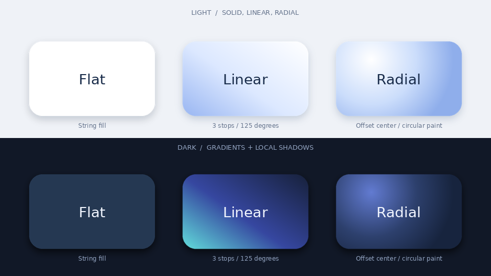
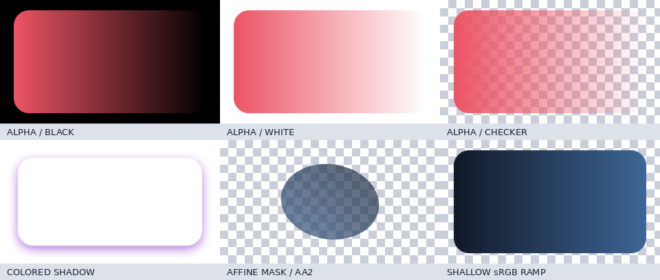

# Premium effects: Phase 2A verification

Phase 2A implements immutable linear/radial gradients and one-shot gradient
surfaces on `codex/premium-effects-2a`. The baseline is local revision
`e1312dd409da072e38f308095491418836e9699d`. The approved
[architecture decision](decisions/premium-effects-architecture.md) remains the
scope boundary; runtime effect stacks, glow/blur, backdrop glass and effect
animation are not implemented. No merge, push or PR was performed.

## Implementation and compatibility

* `gradients.py`: frozen GradientStop/LinearGradient/RadialGradient descriptions,
  strict 2–64-stop validation, normalized coordinates and pure premultiplied
  encoded-sRGB math. Mutable collections are captured as tuples.
* `_surface_raster.py`: 64-row native Pillow field/color stages, exact cardinal
  line expansion, precision fallback, bounded allocations and explicit native
  buffer cleanup. No global caches or NumPy dependency.
* `surfaces.py` / package exports: gradient dispatch, `gradient_surface`, existing
  Image source encoding and component options. Existing string-fill rasterization,
  ShadowStyle fields, clearance and content-bounds formulas retain their pixels.
* New gradient shadows blur only L-mode coverage. Rounded geometric coverage gets
  a fixed 0.75-source-pixel antialias filter; face/shadow replacement mixes float
  premultiplied channels in tiles. A visual regression exposed bright pixels after
  successive resize/rotate; the antialiased coverage removed the fixture's white
  fringe and has a dedicated regression test. Opaque rectangular backdrops bypass
  this edge stage. No renderer or timeline changes were needed.
* Limits are 8192 per source side, 8,388,608 source pixels and a conservative
  192 MiB construction estimate; overflow/huge inputs fail before allocation.
  A full 1080p design at 2x fits. Scratch estimates include the coverage compositor.

Both factories still return ordinary Images. Shape/Text/Canvas/Chart/Flow/Arch
schemas, Spring property restrictions, GIF/HTML source clocks and parent
opacity/mask/z-order behavior remain intact. Of the existing production files,
only `__init__.py` and `surfaces.py` changed; the new rendering helper remains a
one-shot factory implementation. The renderer, motion, layout, timeline, Spring,
exporter, dependency declarations, kit and agent source files are unchanged.

## Tests and focused review

* Full core: **1349 passed, 2 skipped**, 127.70 seconds in the completed serial run.
* Kit: **255 passed**, 104.06 seconds; agent: **41 passed**, 92.16 seconds.
* Total: **1645 passed, 2 skipped**. Skips are existing opt-in Chromium integrations.
* Final focused gradient/surface/example suites: **79 passed**, 10.27 seconds, including the final transparent-chart integration check.
* Ruff lint passes for `src tests examples`; all ten changed/new Python files pass formatting.
* Whole-tree formatting retains three pre-existing failures: `examples/chesschamp/showcase.py`, `src/faceless_champ/layout.py`, and `tests/test_surfaces.py`. The touched `surfaces.py` was formatted.
* `git diff --check` passes. One concurrent full-core attempt was terminated with exit 143; it was not counted as successful. The completed serial result above replaces it.

The new suites cover independent color/geometry references, exact endpoints,
off-center radial geometry, malformed inputs, finite limits, duplicate stops,
bounded infinite iterables, narrow-stop/tiny-radius fallbacks, translucent paint,
colored shadows, fractional coverage, AA1/2/4 resampling, transformed/nested masks,
local stacking and inherited opacity, Spring/source-time seeking, cached GIF and
prepared HTML clocks, no regeneration during replay, source invalidation,
weak-reference lifecycle checks and injected-construction failure cleanup.

The many-stop regression checks 16,000 samples, including 64-stop paints; maximum
native/scalar channel error is one 8-bit level. An additional independent
weighted-alpha test does not call the production interpolation helper.

Legacy fixtures were captured before implementation at the pinned revision and
include opaque, default-shadow, colored-shadow and translucent string cards.
Raw RGBA matches exactly; encoded PNG equality is pinned to the recorded Pillow
version. All six Phase 0 source frame hashes also match the current renderer.
The old/new benchmark independently loads the pinned factory and compares raw
pixels before timing.

Focused local review examined validation-before-allocation, frozen snapshot
ownership, alpha multiplication, zero-alpha RGB, mask ordering, cache retention,
exception cleanup, precision fallbacks and package exports. Review findings about
Pillow in-memory context cleanup and transformed pale-edge ringing were fixed and
covered by regressions. No production-code TODO remains for Phase 2A.

## Visual and media evidence





The complete preview is **6.000 seconds, 960x540, 30 FPS, 180 silent H.264 frames**.
Three additional two-second 960x540 exports contain 48/60/120 frames at 24/30/60
FPS. All four outputs pass FFprobe and full FFmpeg decode. Six decoded frames are
compared against their matching source timestamps; errors are recorded in the
[raw media evidence](decisions/premium-effects-2a-evidence/verification.json).

Source frame hashes match after forward/reverse/shuffled frame workloads at all
three frame rates, with scene-frame caches disabled/enabled: 144 comparisons at
320x180/AA1 after six complete source-sampling workloads. Unit tests additionally
exercise masked/nonuniform Spring composition and repeated/random seeks.

Visual inspection covers six source-time PNGs, six decoded PNGs, the 3x2 comparison,
alpha against black/white/checkerboard, colored shadows, rotated masks, a shallow
ramp, a 1080p/AA2 still and a 4K/AA1 smoke still. These smoke stills confirm
composition at higher output sizes; fixed 2x paint is still a raster and may soften
under magnification. No long 4K export is claimed.

Twenty actual two-frame export/close cycles complete with zero retained entries
in the inspected image/sprite/scene-frame caches. Separate weak-reference tests
verify no retained scene, descriptor, component or renderer instances. Whole-process
RSS includes native allocations and allocator retention; it is not a leak oracle.

## CPU and native-memory measurements

| Replay at AA1 | Pinned legacy solid | Current solid | Linear | Radial |
| --- | --- | --- | --- | --- |
| 960x540 | 8.27 ms | 8.40 ms | 8.54 ms | 9.40 ms |
| 1920x1080 | 28.60 ms | 27.90 ms | 30.17 ms | 28.53 ms |

Current solid versus legacy is +1.63% at 960x540, -2.44% at 1920x1080. Both meet the no-effects regression gate. Different paint pixels and host variation affect individual trials; new gradients use the ordinary Image path, with no per-frame paint generation.

| One-time construction, 2x source | Seconds | Whole-process peak RSS MiB | Peak increase over import high-water MiB |
| --- | --- | --- | --- |
| linear-card | 0.376 | 43.82 | 12.63 |
| radial-card | 0.387 | 43.76 | 12.57 |
| cardinal-1080 | 0.827 | 126.92 | 95.62 |
| linear-1080 | 4.346 | 130.51 | 99.32 |
| radial-1080 | 4.806 | 130.62 | 99.41 |
| rounded-1080 | 4.995 | 172.33 | 141.14 |

The largest measured case is a rounded 1080p card with a colored shadow and fractional coverage mixing. Its native-inclusive construction increase stays below the 192 MiB working-set estimate. These are measured cases, not a hard bound on whole-process RSS or unrelated renderer caches.

Measurements use the local AMD A6-9225 CPU, Python 3.12.3 and Pillow 12.3.0.
Construction workers are isolated processes; RSS includes interpreter/imports and
native Pillow buffers. Replay uses seven interleaved trials of eighteen changing
timestamps, six two-child groups, AA1, warmed sprites and no FFmpeg/tests during
timing. Raw trials, not just medians, are preserved in
[the benchmark evidence](decisions/premium-effects-2a-evidence/benchmark.json).
The comparison against legacy uses the pinned factory in the unchanged renderer;
it is not an independently timed checkout of every historical module.

## Commands and package checks

```bash
UV_CACHE_DIR=/tmp/fc-premium-phase0-uv MPLCONFIGDIR=/tmp/fc-premium-phase0-mpl uv run --offline --no-sync pytest -q
UV_CACHE_DIR=/tmp/fc-premium-phase0-uv MPLCONFIGDIR=/tmp/fc-premium-phase0-mpl uv run --offline --no-sync pytest -q facelesschamp-kit/tests
UV_CACHE_DIR=/tmp/fc-premium-phase0-uv MPLCONFIGDIR=/tmp/fc-premium-phase0-mpl uv run --offline --no-sync pytest -q facelesschamp-agent/tests
UV_CACHE_DIR=/tmp/fc-premium-phase0-uv uv run --offline --no-sync ruff check src tests examples
.venv/bin/python examples/premium_effects/render.py --frames --overwrite
.venv/bin/python examples/premium_effects/verify.py
.venv/bin/python examples/premium_effects/benchmark.py
UV_CACHE_DIR=/tmp/fc-premium-phase0-uv uv build --offline --no-build-isolation --out-dir output/premium_effects/phase2a/dist
```

The cache override is required by this workspace's read-only default uv cache.
No dependency download, GPU installation or live browser capture occurred.
Wheel/sdist builds and an isolated installed-wheel import/gradient/Group/Spring/
AA2 seek smoke use the existing local third-party runtime. This is not a fresh
dependency-resolution claim. Artifacts are under `output/premium_effects/phase2a/`;
the guide documents their reproducible entrypoints.

## Limits and review boundary

* Runtime verification used Pillow 12.3.0. The existing declared minimum is 10.4;
  the callable ImageMath API is supported there (introduced in Pillow's
  [10.3 release](https://pillow.readthedocs.io/en/stable/releasenotes/10.3.0.html)).
  No supported lower-version runtime was installed locally, and no version-matrix
  run is claimed. The available system Pillow 10.2 is outside the package range.
* Very narrow stops or tiny radial radii select scalar sampling in bounded tiles
  for the whole paint. This favors correctness; selective pixel repair is a
  possible later construction optimization, with no effect on frame replay.
* Color and PNG output are 8-bit encoded sRGB, without stochastic dithering or
  linear-light interpolation. High magnification remains bounded by 2x source
  detail. New-gradient allocation limits do not bound legacy asset/GIF caches.
* Legacy colored-shadow fringes are deliberately retained for string fills.
  Correcting those existing pixels requires a separate approved change.

**Phase 2A local CPU acceptance gate passes and A1–A4 are complete.** Public APIs,
regressions, docs, examples, visual/media inspection, performance/memory checks and
packaging are delivered with the environment limits above. Review/merge is the
next boundary. Phase 2B has not started.
