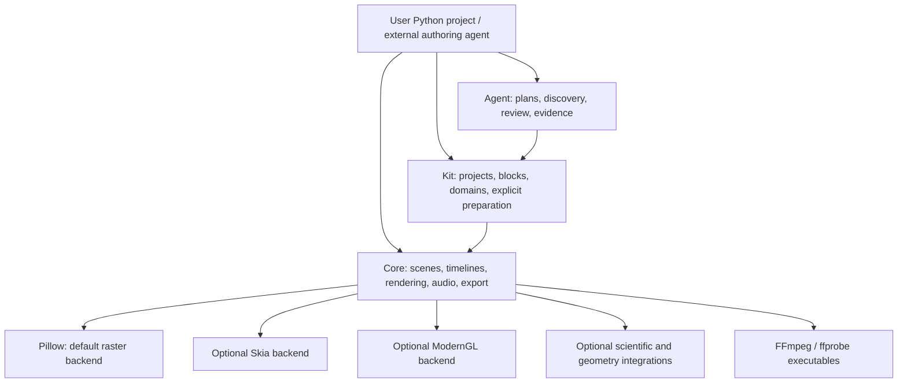

# FacelessChamp V2 architecture proposal

Status: original proposal with M1-M5 implementation follow-up below. Audited source: `master` at
`22f3beaccb5a56990bd0974666b7c639a0667a68` (2026-10-20). The `v2`
branch pointed to the same commit. See the [audit](architecture-audit.md),
[feature decisions](feature-decisions.md), and [migration plan](migration-plan.md).

Implementation follow-up: [M1](m1-implementation.md), [M2](m2-implementation.md),
[M3](m3-implementation.md), [M4](m4-implementation.md) and
[M5](m5-implementation.md) record the implemented changes and scoped evidence.
The original proposal and audit measurements below retain their dated baseline.

## Recommended architecture

Keep three independently installable distributions. Core must support an offline
2D scene and FFmpeg export without Kit, Agent, a browser, CAD, or a model service.
Kit adds reusable authoring. Agent adds production planning and evidence. Installation
of a higher layer must not require every optional capability below it.

Arrows mean dependency/use, not a second timeline. No Core module may import Kit
or Agent. Kit may use public Core interfaces; it must not import private renderer
state. Agent production operations use Kit services. Agent discovery may inspect
Core source metadata and package resources through a Kit discovery facade without
executing optional integrations.

## Ownership

| Owner | Responsibilities | Explicit boundary |
| --- | --- | --- |
| Core | Canvas, components, tracks, schedules, Spring, groups, composition, measurement contracts, backend selection, resource sessions, prepared-source playback, audio events, streaming export, preview publication | No project templates, lesson semantics, desktop simulation, chess rules, LLM runner, or implicit preparation |
| Core optional integrations | PyVista viewport sessions and immutable dataset snapshots; build123d/OCCT preparation; Trimesh processing; MathText adapter; native rendering adapters | Native objects stay outside generic scene snapshots; import and allocate only on explicit use |
| Kit | BuildContext, Video/Segment, Project/configuration, themes, measured allocations, blocks, recipes, coding/diagram/chart/map/desktop authoring, browser and checkpoint preparation | Compiles through public Core; does not evaluate a parallel visual timeline or own encoders |
| Agent | Context discovery, scene selection, typed plans, plan/build conformance, artifact/review history, narration alignment, verification policy, generated entrypoints | No duplicated frame/export pipeline; media quality and editorial approval remain separate evidence |
| Project | Content, data, fonts/assets, narration, cue files, custom shaders and specialist scientific logic | Project-specific cloud launchers and illustrative engineering models are not automatically promoted into Core |

The optional integrations remain in the Core wheel, with lazy dependencies. Domain
authoring remains in the Kit wheel. This avoids a distribution per feature while
keeping imports and ownership focused. See [dependency analysis](dependency-analysis.md).

## Canonical scene representation

Preserve the public `Scene`, `Sequence`, `Grid`, `Layer`, animation builders, and
snapshot-on-add semantics. Introduce a private compiled representation before
changing their storage. It is an internal execution contract, not a universal JSON
format or a replacement authoring language.

The compiled graph contains:

- One immutable visual snapshot per authored component, addressed by a stable
  compilation-local node ID. Group membership is expressed by child IDs; a group
  does not retain another complete copy of every descendant.
- Ordered per-property tracks, lifetimes, parent/child relationships, and stable
  sibling ordering. Compile track indexes once; preserve exact endpoints and the
  existing interpolation and Spring certification rules.
- Shared immutable paints, path descriptions, image/font identities, and prepared
  source descriptors. Live fonts, plotters, GL handles, browser objects, and CAD
  kernels are renderer/preparation resources, not graph payloads.
- Composition placements and audio events retaining original source offsets.
  Composition stays hierarchical where crossfades, masks, and effects require it.

For a requested source time, evaluate the graph once into a frame plan containing
resolved transforms, visible lifetimes, paint values, logical/ink bounds, source
times, resource keys, and ordered drawing/isolation operations. All built-in
backends consume that plan. They do not independently traverse mutable `Scene.entries`.

Use a small set of operations: shapes/paths, text, images, external viewports,
group isolation, masks, effects, and composition placement. Reuse `PathData`,
gradient descriptions, `Bounds`, and existing affine math. Keep primitive fast
paths; converting every rectangle into a freshly allocated path each frame would
defeat this design.

Dynamic source-time scenes used by project-local custom renderers remain supported
through the existing Renderer protocol. Do not require all callables or arbitrary
Python projects to become serializable. Public IR construction is deferred until
the private representation has passed backend parity tests.

## Shared evaluation and measurement

Move the responsibilities currently spread across `_composition_plan.py`,
`_render_state.py`, Pillow traversal, Skia traversal, and `_compositor.py` into
shared compilation/evaluation/composition services. Native painting remains
backend-specific. This is consolidation of semantics, not one large renderer base class.

Measurement must not construct a `PillowRenderer` for each bounds query. Provide
a build/session-owned measurement service, using the declared text engine and
intrinsic image/viewport dimensions. Logical bounds and ink bounds stay distinct.
Do not decode a scientific viewport, open GL, run code, or launch a browser merely
to measure its rectangle.

Domain-specific properties are validated by the component that owns them through
`Component.validate_animation(property, value)`. Core retains validation for its
own transform, paint, mask, and effect properties. Chart structure and geographic
latitude/zoom rules move with those domains. Domain animation builders reuse
Core's interpolation/scheduling rather than teaching Core about each domain type.

## Rendering and resource interfaces

Keep the public `Renderer.validate(node)` and
`Renderer.frame(node, time, size) -> PIL.Image.Image` contract. Helpers close
renderers they create; supplied custom renderers remain caller-owned. Built-in
factories provide managed sessions with `close()`, runtime identity, and statistics.

Add one generic `Viewport` component around a `RasterSource` descriptor. A source
declares intrinsic dimensions, duration, fingerprint, source-time frame keys,
requirements, and a session factory. Its session owns native resources and returns
straight-alpha sRGB RGBA images. Detailed contracts are in
[backend integration](backend-integration.md) and [API design](api-design.md).

The generic evaluator and compositor know the viewport contract, not `ChessChamp`,
`OSClip`, `FlowChamp`, `ArchChamp`, or browser implementation classes. Retain legacy
raster producers through adapters until each domain's shared-primitive lowering
has passed visual parity. A domain rewrite is not a prerequisite to establish the seam.

Keep VTK isolated from ModernGL where required. Preserve the existing floating-point
environment guard when mixing VTK and Skia. A triangle-only replacement for
`ArchMesh` is rejected because current scientific viewports support grids and
point/cell/field data. Native scientific snapshots belong inside the optional
PyVista adapter; the generic scene stores their source descriptor.

Keep low-level `ArchPart` and `ArchStyle` contracts with the optional Core PyVista
snapshot/camera types. Core CAD conversion returns those native part descriptors;
it must not import Kit to construct its results. Kit engineering reuses/re-exports
them and owns semantic scripts, labels/dimensions and structured design composition.

## User-facing defaults and invariants

- Pillow stays the default; existing export antialias/fidelity defaults stay intact.
  Skia native text remains explicit. Native Skia AA1 is a profile choice, not a
  silent change to Pillow AA2 output quality.
- Explicit unavailable backends fail with installation/native-driver details.
  `auto` remains opt-in, excludes software GL as automatic acceleration, records
  the resolved backend, and never switches mid-export.
- Timelines remain random-access: sampling `t2, t0, t2` yields the same `t2` image
  within a fixed backend/dependency/font/platform environment.
- Preserve source cue numbers, timestamps, tolerated overlaps, master audio at
  zero, ranged-export clocks, terminal holds, and frame-count calculation.
- Preserve descendant opacity propagation and mask/effect ordering. Replacing
  multiplication of child opacity with a single group save-layer alpha would
  change overlapping pixels and is not an incidental refactor.
- Keep bounded renderer caches, independent returned frames, explicit resource
  release, and atomic publication. Cache budgets do not claim to bound total RSS.
- Preserve Agent's distinction between structural validation, layout sampling,
  preview verification, full export verification, visual review, and editorial review.

## Compatibility and release boundaries

Deprecate domain imports in a V1 maintenance release before moving them into Kit in
V2. Preserve shared Core APIs through aliases within Core. Do not forward removed
Core domain imports into Kit: that would reverse the dependency boundary.

Unchanged legacy projects, including ChessChamp projects, can run from the frozen
V1 source commit in an isolated environment. Do not assume a matching published
PyPI release exists. Provide exact source-commit and dependency-lock instructions.
Move domain implementations once; do not maintain two independent implementations
throughout V2. Existing prepared data/schema adapters remain readable where their
semantics are unchanged; incompatible data changes require explicit migrations.

No global plugin discovery, service container, ECS, universal property class
hierarchy, second 3D engine, mandatory NumPy, PyAV, MoviePy, or mandatory browser is
introduced. Shared utilities should be small functions/protocols at demonstrated
seams. Each migration phase has an independent parity gate and rollback path.
